# Navigation concepts: leading people through the app

> **Outcome: approach A (the menu follows you) was chosen and is implemented.** See
> [../../design.md](../../design.md#navigation-the-menu-follows-you) for how it works and
> [../../decisions.md](../../decisions.md#navigation-the-menu-follows-you) for why, including the owner's answers to the
> questions below. This folder is the archive of the three mock-ups; the screenshots show the mock-ups, not the app.

Three ways to lead a writer through Home → Profile → Idea, drawn with the real Ember theme (the pages use
`apps/web/src/theme/`), so what you see is what the app would render. The page bodies are identical in all three; only
the navigation differs, so they compare fairly. These are mock-ups: nothing here changes the app yet.

## What we're solving

Today a profile page mixes "your ideas" with "gather" links, and the **Idea page is one long page**: notes, reading
list, brainstorm, research, drafts and delete, stacked. People have to scroll to find the next thing, and nothing says
where they are in the process. The aim is to split it into sub-pages, give each level a clear set of numbered steps
("01, 02..."), and do it without becoming a wizard that tells writers what they must do next.

## The structure (shared by all three)

| Level   | You are choosing…               | Numbered steps                                                                 | Settings live in |
| ------- | ------------------------------- | ------------------------------------------------------------------------------ | ---------------- |
| Home    | which **profile** to work on    | none (a list, later with recent activity)                                      | Account settings |
| Profile | what to gather, then which idea | **01 Inspiration** · **02 Notes** · **03 Ideas**                               | Profile settings |
| Idea    | how to develop it               | **01 Research** · **02 Notes** · **03 Refine** · **04 Draft** · **05 Publish** | Idea settings    |

How today's pieces map to the steps:

| Step             | What it holds (today's component or page)                                                                                                |
| ---------------- | ---------------------------------------------------------------------------------------------------------------------------------------- |
| Profile 01       | Feeds and recent posts (`InspirationView`), **Add to reading list**, the profile's reading list, **Read and take notes** (`ReadingView`) |
| Profile 02       | Profile notes (`ProfileNotesView`), grouped; a group can become an idea                                                                  |
| Profile 03       | The ideas list (`ProfileView`'s Ideas section), each with counts and a "Continue"                                                        |
| Idea 01 Research | The idea's reading list (`ReadingList`), add link, **Research** (`ResearchView`)                                                         |
| Idea 02 Notes    | `IdeaNotes`: tag, merge, split, order                                                                                                    |
| Idea 03 Refine   | Brainstorm (`BrainstormView`): continue or start again                                                                                   |
| Idea 04 Draft    | The drafts list; opening one goes to the editor (`EditorView`)                                                                           |
| Idea 05 Publish  | **New**: checklist and alternatives to titles/openings the writer wrote (assistance rung 4, as today)                                    |

## Principles all three follow

1. **Numbers orient; they never gate.** Every step is a link, always enabled. Nothing is locked, greyed out, or
   "completed for you". The numeral just says "this is roughly the order things happen in".
2. **State is counts, not progress.** "6 sources", "9 notes", "1 draft" under each step help people resume without a
   progress bar implying a finish line.
3. **You can see where you are in two places:** the current step's badge is filled in the menu _and_ in the page title,
   with the profile or idea name above it.
4. **A suggestion, not a push.** Each page ends with "Next: 03 Refine →" as an outline button (never the primary
   button), omitted where the next move is a choice (Ideas) or there is no next (Publish).
5. **Always a way up.** Each level links to its parent ("← All profiles", "← Notes from the Allotment").
6. **"Pick what's next" screens are lists.** Home and 03 Ideas list their items with counts, and the most recently
   used gets a "Continue" action.
7. **Settings sit apart from the steps**, at their own level, so they never read as part of the journey.
8. **On a phone** the menu folds behind a Menu button, and the current place stays visible when it is closed.

---

## A. The menu follows you

The left menu changes with where you are. On Home it lists Profiles and Account settings; inside a profile it becomes
that profile's three steps; inside an idea it becomes that idea's five. A "← parent" link and the entity's name sit at
the top of the menu.

|                                                                         |                                                                      |
| ----------------------------------------------------------------------- | -------------------------------------------------------------------- |
| 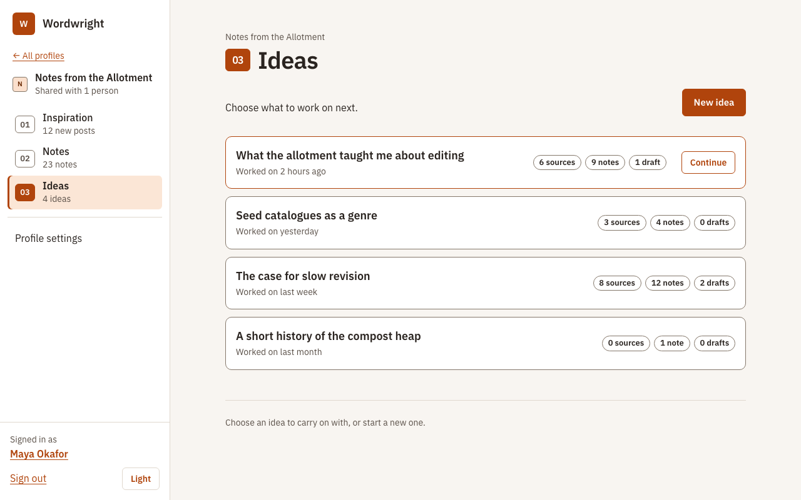                | 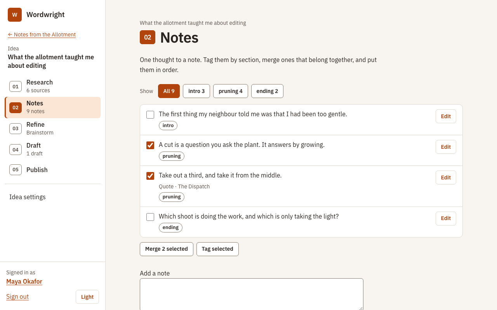                   |
| 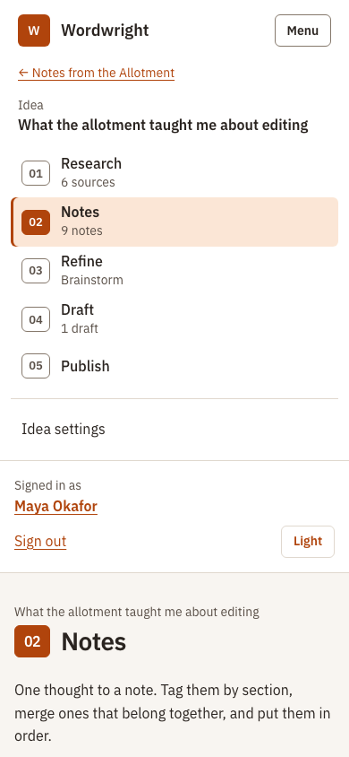 | 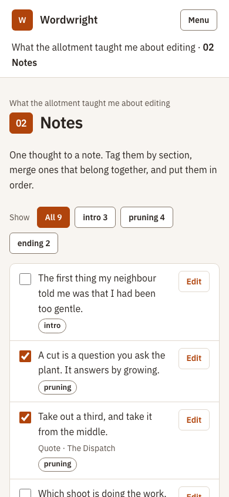 |

**For:** one place to look, and it reads like a journey. The pages stay uncluttered (no second navigation inside
them). The numerals are never ambiguous, because only one level's numbers are on screen. On a phone the menu _is_ the
step list. It is the least change from today's shell. **Against:** the menu's content changes, so the "← parent" link
has to be very clear; to switch to another idea you go up a level (a quick idea switcher, like the profile switcher,
could fix that); a menu that changes can surprise people the first time.

## B. Steady menu, steps on the page

The left menu never changes (profile switcher, Your profiles, Account settings). Inside a profile or idea, the page
gets a header: breadcrumb, the entity's name, and a strip of numbered steps with that level's Settings link at the end.

|                                                          |                                                    |
| -------------------------------------------------------- | -------------------------------------------------- |
| 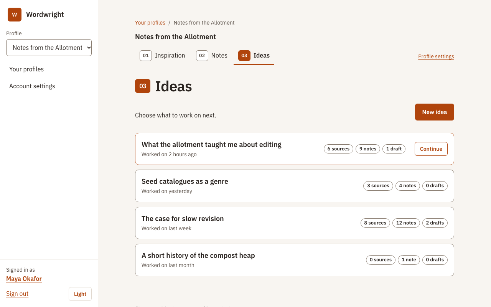 | 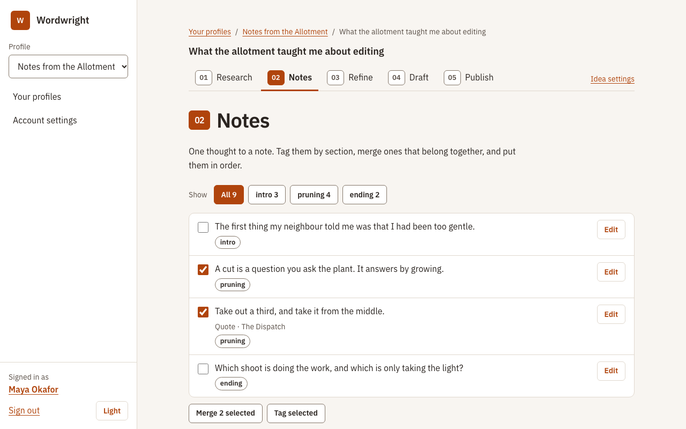 |
| 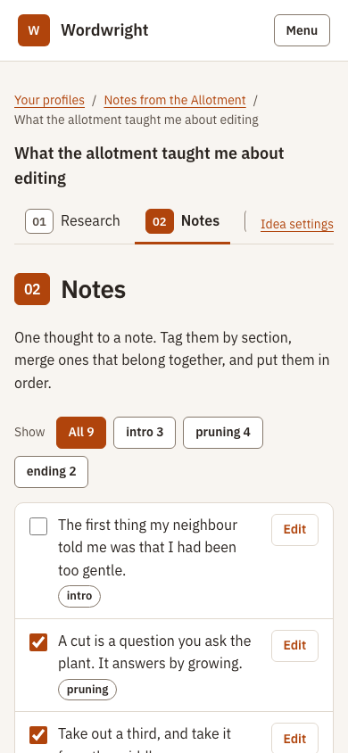  | 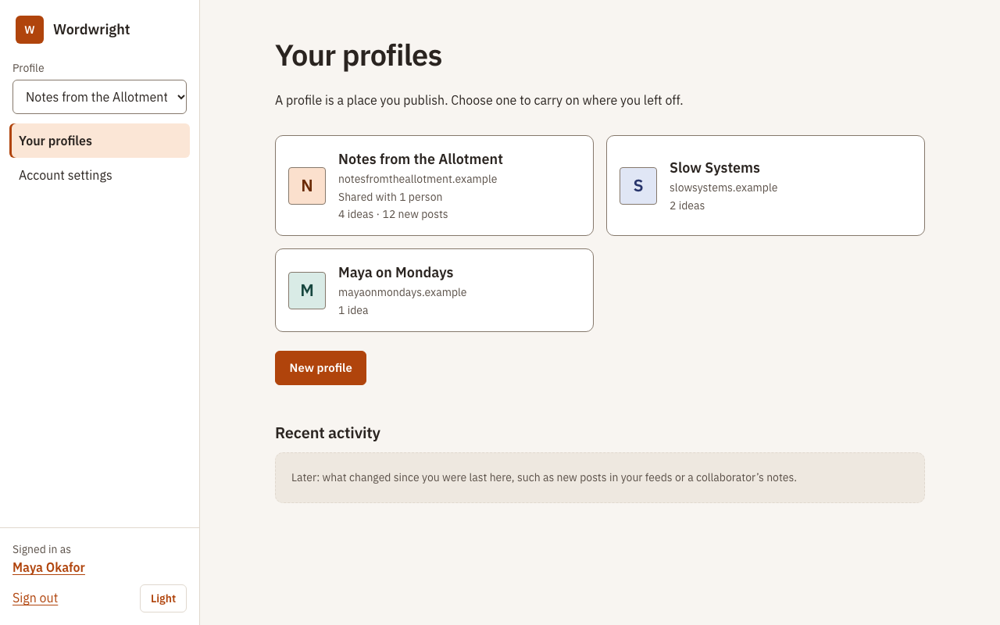                    |

**For:** the app's frame never moves, so nothing needs re-learning; the steps sit right above the content they
control, the way tabs do, and show the whole sequence at a glance (good for the 01–05 feel). **Against:** two
navigation systems at once (menu and strip) and a taller page header on every screen; on a phone the strip scrolls
sideways and later steps (Draft, Publish) can sit off-screen; it is the most "tabs" of the three, which you leaned
away from.

## C. The menu is a map

One tree shows every level at once: your profiles, the current profile's steps, its ideas nested under 03 Ideas, and
the current idea's steps nested under that.

|                                                                         |                                                    |
| ----------------------------------------------------------------------- | -------------------------------------------------- |
| 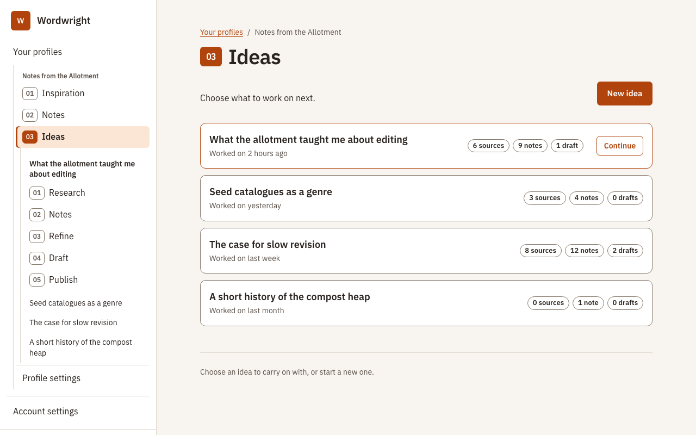                | 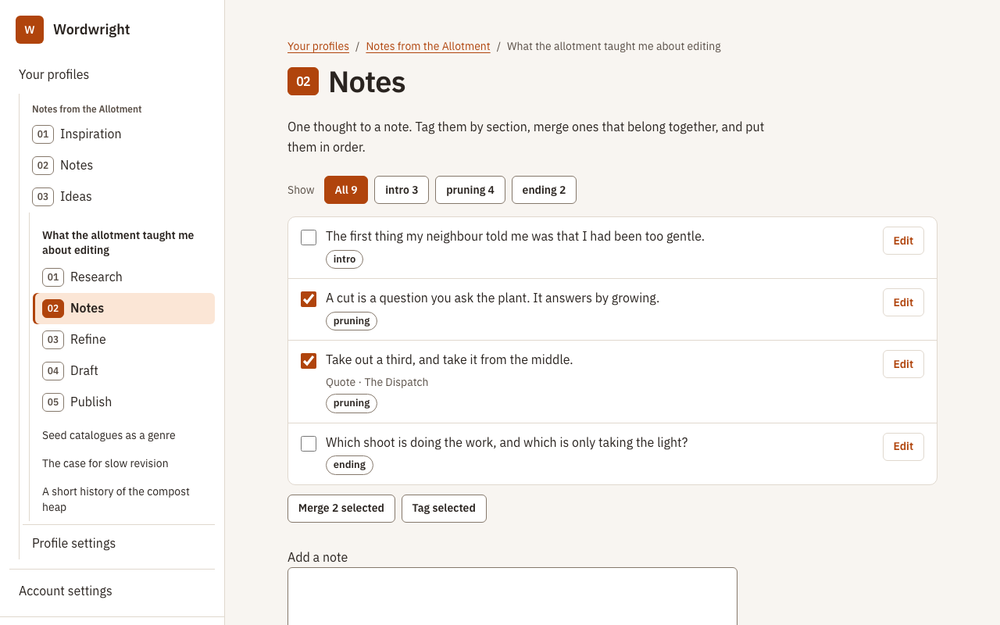 |
| 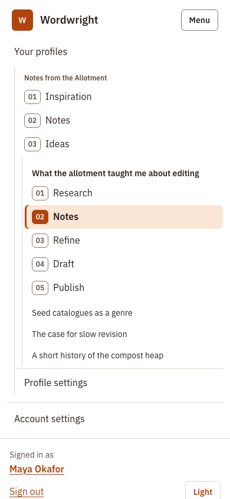 | 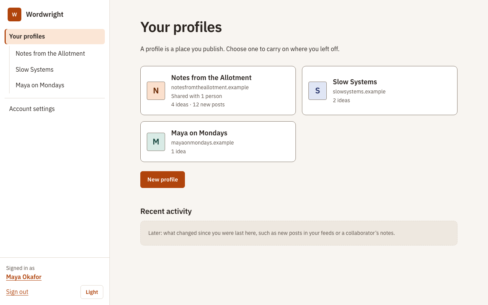                    |

**For:** you can see the whole shape and jump between ideas or profiles without going up; good for people with many
ideas in flight. **Against:** the busiest menu, which cuts against "calm"; it grows with the number of ideas; the same
"01, 02..." numerals appear at two levels in one list, which is confusing; and on a phone it is a long scroll. It
solves a problem (rapid switching) we can't yet say people have.

---

## Side by side

|                       | A. Menu follows you          | B. Steady menu, steps on page | C. Menu is a map        |
| --------------------- | ---------------------------- | ----------------------------- | ----------------------- |
| Where the steps live  | Left menu                    | Strip under the title         | Left menu, nested       |
| Page chrome           | Light                        | Heavier (breadcrumb + strip)  | Light                   |
| Menu stability        | Changes per level            | Never changes                 | Grows and shrinks       |
| Numerals unambiguous? | Yes                          | Yes                           | No (two levels at once) |
| Phone                 | Menu is the step list        | Strip scrolls sideways        | Long menu               |
| Switching ideas       | Up a level (or add switcher) | Up a level                    | One click               |
| Calm / uncluttered    | Highest                      | Medium                        | Lowest                  |
| Matches the leaning   | Yes                          | Closest to tabs               | Partly                  |

## Recommendation

**A, with two borrowings.** It is the calmest, keeps the numerals unambiguous, turns the menu into the step list on
a phone, and fits the leaning toward the left menu. Borrow from B the **breadcrumb above the page title** (already in
the drawn pages as the entity name), and from C a small **idea switcher** under the idea's name (a select, like the
profile switcher) so you can change ideas without going up, if people turn out to need it. Rule out C as the base
(too busy) and B (tabs, and the phone strip).

## Questions this raises (for you)

1. **Profile Notes vs Idea Notes.** Profile 02 shows all notes from your sources, grouped; "Make an idea from this
   group" starts an idea. Do those notes then _appear in_ the idea (shared, so editing one edits both) or get copied?
   The menu uses the same word "Notes" at both levels, which works only if they feel like the same material.
2. **Where does the reading list live?** The mocks put it in Profile 01 (so Inspiration is: feeds → reading list →
   read and take notes) and in Idea 01 (with a "Choose from the profile's list" action). Should the idea's list be a
   view onto the profile's, or its own?
3. **05 Publish** has no content today. The mock is a placeholder (checklist and alternatives to titles/openings the
   writer wrote, assistance rung 4). What should it really be?
4. **The editor.** Drafting is a wide, focused page with a notes column. Should the menu stay there, or shrink to a
   slim bar to give the writing room?
5. **Recent activity** on Home is shown as a later placeholder. Fine to leave out until it has content?
6. **Idea settings** (rename, delete, maybe move to another profile) is shown as a menu item; there is no page for it
   yet.

## If we adopt A: what would change in the app

- **Routes** nest under their level: `/p/:profileId/{inspiration,notes,ideas,settings}` and
  `/p/:profileId/ideas/:id/{research,notes,refine,draft,publish,settings}`. Today's `/p/:id` and `/p/:id/ideas/:id`
  redirect to the first step (or to Ideas for a profile). `reading/:linkId` and `drafts/:id` keep their addresses.
- **Shell:** `App.vue`'s menu is driven by route meta (level and step) instead of fixed links. Each level's nav has its
  own accessible name ("Profile", "Idea") and `aria-current="page"`; the drafting notes column keeps the `complementary`
  landmark to itself.
- **Idea page split:** `IdeaView.vue` (248 lines) becomes five small views reusing today's components (`ReadingList`,
  `IdeaNotes`, the brainstorm entry, the drafts list); the profile page's Ideas list moves to 03.
- **New in the theme:** `step-num` / `step-num-current` (see `theme.css` here), plus a `nextStep` footer component.
- **Tests:** several e2e specs click links by name (`Brainstorm`, `Research`, `Inspiration`, `Settings`). Menu links with
  the same names would collide, so those specs get scoped to `main` (or the menu links are named with their numeral,
  "02 Notes"). Worth doing in the same change.

## Looking at them

```bash
node docs/design-concepts/navigation/build.mjs   # regenerate the pages (a/, b/, c/)
pnpm --filter @lfwa/web exec vite --config ../../docs/design-concepts/tools/vite.config.mjs
# then open http://localhost:5199/navigation/  (all pages), e.g. /navigation/a/idea-notes.html
node docs/design-concepts/navigation/shoot.mjs   # regenerate screenshots/ (server running)
```

Add `?menu=open` to a page to see the phone menu open (resize the window under 768px), or `?theme=dark` for dark mode.
