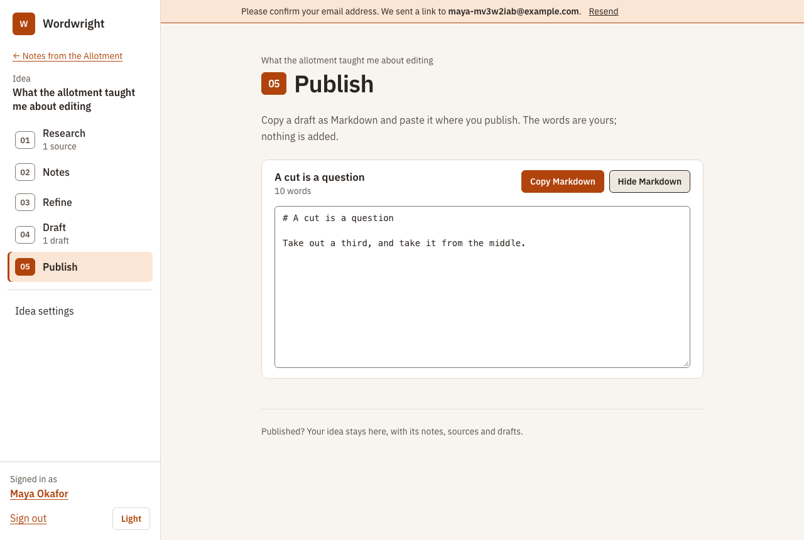
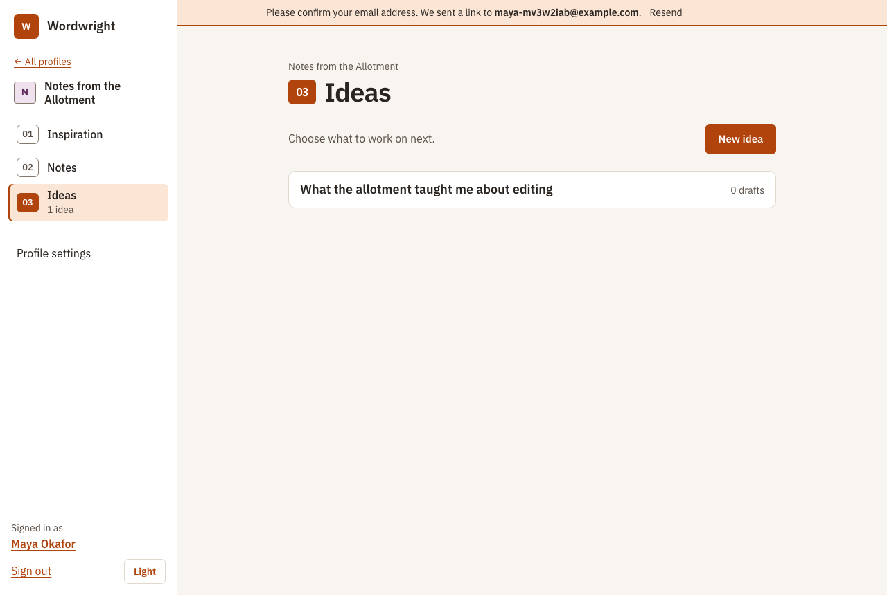

# Design system: Ember

How Wordwright looks, why, and how to keep it that way. Read this before changing anything people see. The short
version is in [AGENTS.md](../AGENTS.md); the reasoning behind choosing this design, and the alternatives we dropped,
are in [decisions.md](decisions.md#visual-design-ember) and the archive in [design-concepts/](design-concepts/README.md).

**Ember** is a calm, clear tool for writing: warm stone neutrals, one burnt-orange accent, IBM Plex Sans everywhere,
a side menu, 1px outlines on everything you can press or type in, and a designed dark mode.

## What it looks like

The running app (these are screenshots of the real thing, not mock-ups):

|                                                         |                                                                     |
| ------------------------------------------------------- | ------------------------------------------------------------------- |
|                 |                        |
|  |  |

## The principles

1. **Calm, not busy.** Few colours, generous space, no shadows, gradients or decoration. Content leads.
2. **Obvious what you can do.** Every button and field has a fill or a visible 1px border; links are always
   underlined; icon buttons keep a faint outline. Colour is never the only signal (errors say so in words, with an icon).
3. **One sans, everywhere.** The editor, the AI's replies and the chat use the same family as the buttons, only
   larger and looser. No serif, no monospace for metadata.
4. **The highlighter is rationed.** The pale `mark` colour means "the AI suggested this". Use it for nothing else. If
   it is everywhere it marks nothing, and the writer's own words must stay visually theirs.
5. **Roles, not colours.** Markup says what something _is_ (`bg-surface`, `text-ink-soft`, `btn btn-primary`), never
   what it looks like (`bg-white`, `text-stone-600`). That is what makes palettes and designs swappable.
6. **Other people's pictures are guests.** Logos and icons from other websites never appear bare (below).
7. **Accessible by construction.** The palette's contrast is tested; focus, target size, text size and motion are
   handled once in the theme, not per screen.

## Where it lives

| File                                                    | Job                                                                                                                                                                                               |
| ------------------------------------------------------- | ------------------------------------------------------------------------------------------------------------------------------------------------------------------------------------------------- |
| `apps/web/src/theme/palette-ember.css`                  | **The only place a colour is chosen**: light, dark, and lettered-tile tints, each named by role.                                                                                                  |
| `apps/web/src/theme/theme.css`                          | The design built on a palette: fonts, the Tailwind token map, shared base rules (focus, selection, reduced motion), and every component utility (`btn`, `field`, `panel`, `chip`, `callout` ...). |
| `apps/web/src/style.css`                                | Imports the two above, plus the editor and Markdown typography.                                                                                                                                   |
| `apps/web/src/theme/palette.test.ts`                    | Fails if any colour pair on screen drops below WCAG 2.2 AA, in light or dark.                                                                                                                     |
| `apps/web/src/lib/useTheme.ts`                          | The light/dark choice (saved in `localStorage`, applied as `data-theme` on `<html>`, defaults to the system).                                                                                     |
| `apps/web/src/assets/fonts/`                            | Self-hosted IBM Plex Sans (OFL). No third-party font requests.                                                                                                                                    |
| `apps/web/src/App.vue`                                  | The shell: side menu (a Menu button on phones), skip link, landmarks.                                                                                                                             |
| `apps/web/src/lib/nav.ts`, `components/SideMenu.vue`    | What the side menu lists for where you are (see _Navigation_).                                                                                                                                    |
| `components/StepHeading.vue`, `components/NextStep.vue` | A numbered step's title, and its \"Next: …\" suggestion.                                                                                                                                          |

Tailwind's default colour palette is **switched off** (`--color-*: initial` in `theme.css`). A class like `bg-red-50`
or `text-stone-600` does nothing, so off-palette colour can't creep in unnoticed. Only the roles below exist.

## Colour roles

Use the role that matches the _meaning_. Values below are Ember light; dark has its own set in the same file.

| Role (Tailwind class)                                  | Light     | Use                                                                                                     |
| ------------------------------------------------------ | --------- | ------------------------------------------------------------------------------------------------------- |
| `paper` (`bg-paper`)                                   | `#f8f5f1` | The page                                                                                                |
| `surface` (`bg-surface`)                               | `#ffffff` | Raised areas: panels, cards, inputs, the side menu                                                      |
| `sunken` (`bg-sunken`)                                 | `#eee8e0` | Recessed areas: code, disabled fields, quiet hover, secondary panels                                    |
| `ink` (`text-ink`)                                     | `#2a2420` | Body text                                                                                               |
| `ink-soft` (`text-ink-soft`)                           | `#594f47` | Secondary text: hints, dates, counts, explanations. **Not** for disabled-looking text that must be read |
| `line` (`border-line`, `divide-line`)                  | `#e0d8ce` | Decorative dividers and quiet panel edges                                                               |
| `line-strong` (`border-line-strong`)                   | `#85786b` | Borders you need to see: fields, neutral buttons (3:1)                                                  |
| `accent` (`bg-accent`, `text-accent`, `border-accent`) | `#b0440c` | The single brand colour: primary buttons, links, current item, focus ring                               |
| `accent-strong`                                        | `#8a3207` | Hover and pressed                                                                                       |
| `on-accent` (`text-on-accent`)                         | `#ffffff` | Text or icons placed on `accent`                                                                        |
| `accent-wash` (`bg-accent-wash`)                       | `#fbe6d6` | Tinted background: notices, counts, the current menu item, hovered cards                                |
| `mark` (`bg-mark`)                                     | `#cfe6f2` | The highlighter. **AI-suggested things only**                                                           |
| `danger`, `on-danger`, `danger-wash`                   | raspberry | Errors and destructive actions. Raspberry, not red, so it never looks like the orange accent            |
| `ok`, `ok-wash`                                        | green     | Success                                                                                                 |
| `focus`                                                | `#b0440c` | Keyboard focus ring (set globally; you rarely touch it)                                                 |
| `tint-1`..`tint-6` (`tint-1` class)                    | muted     | Lettered tiles when there is no picture                                                                 |

Rules:

- **Never write a colour value** (hex, `rgb()`, a Tailwind palette name) in a component. If you need a new role,
  add it to the palette file (light, dark, and the system-dark copy), map it in `theme.css`, and add its pairs to
  `palette.test.ts`.
- **Don't use `accent` for decoration.** It means "you can act here" or "this is where you are". `accent-wash` is the
  background for information that isn't an action.
- **Text on a coloured background uses the matching `on-` role or `ink`**, and the pair must be in the test.
- **Danger is for errors and irreversible actions only.** Pair it with words and, where space allows, an icon.

## Type

IBM Plex Sans in four files (400, 400 italic, 500, 600). Sizes, set once:

| Use                                   | Class / rule                             | Notes                                                          |
| ------------------------------------- | ---------------------------------------- | -------------------------------------------------------------- |
| Page title                            | `h1`                                     | 28–38px, 600, balanced                                         |
| Section heading                       | `h2`                                     | 20px, 600                                                      |
| Subsection / card heading             | `h3`                                     | 17px, 600                                                      |
| Body, labels, buttons                 | default (16px) / `text-sm` for secondary | Never below 14px for anything read, 12px only for tabular tags |
| Secondary line (dates, hosts, counts) | `meta`                                   | 14px, `ink-soft`, tabular figures                              |
| The editor and the AI's replies       | `.prose-editor`, `.markdown`             | 18px, line-height 1.75, same family                            |

Figures are tabular by default so counts and dates align. Don't add other typefaces. Headings use `font-display`
(currently the same family), so a different display face is one line in `theme.css`.

## Shape, space and depth

- **Corners:** `rounded-ctl` (6px) for buttons and fields, `rounded-panel` (10px) for panels, cards and dialogs,
  `rounded-full` for chips and avatars only. Don't use bare `rounded` (it is not defined in this system).
- **Edges:** 1px. A quiet `line` for containers, `line-strong` for controls, `accent` for the current/hovered thing.
- **No shadows or gradients.** Separation comes from tone (`paper`/`surface`/`sunken`) and a 1px edge.
- **Spacing:** Tailwind's scale; page sections `mb-8`–`mb-12`, panel padding `p-4`/`p-5`/`p-6`. Read neighbouring
  screens first and match them.

## Components (utilities in `theme.css`)

Use these instead of long utility strings. If you find yourself repeating a recipe, add a component here.

| Class                                                             | Use                                                                                                                                                                                      |
| ----------------------------------------------------------------- | ---------------------------------------------------------------------------------------------------------------------------------------------------------------------------------------- |
| `btn` + `btn-primary`                                             | The one main action on a screen                                                                                                                                                          |
| `btn btn-outline`                                                 | A secondary action that matters (e.g. Brainstorm, Open)                                                                                                                                  |
| `btn btn-neutral`                                                 | Everything else: Cancel, Add link, Previous/Next                                                                                                                                         |
| `btn btn-danger` / `btn btn-danger-solid`                         | Delete: outline to start, solid only on the final confirmation                                                                                                                           |
| `btn btn-quiet`                                                   | Icon-only and low-emphasis actions (edit, remove, reorder grips). Keeps a faint outline                                                                                                  |
| `btn-sm`                                                          | Add to any `btn` in dense lists (36px high; normal is 44px)                                                                                                                              |
| `btn-icon`                                                        | With `btn-sm btn-quiet`: a square button holding only an `Icon`, named by an `aria-label` and a tooltip                                                                                  |
| `switch` (+ `SwitchField`)                                        | The on/off state of one thing, saved when flipped (Read, Keep, Show read). Never a checkbox: see _Actions and lists_                                                                     |
| `list-rail`                                                       | The left zone of a list row: select checkbox; for reorderable lists it is dotted (`list-rail-grab`) and clicking it shows the arrows                                                     |
| `field`, `field-compact`                                          | Text inputs, selects, textareas. `aria-invalid="true"` gives the error style. Use `TextField`/`TextAreaField` for labelled ones                                                          |
| `panel`, `panel-sunken`                                           | A grouped container. Put `divide-y divide-line` on a list inside it                                                                                                                      |
| `card`                                                            | A whole-area link or button that lifts on hover (e.g. a profile). Add layout classes yourself                                                                                            |
| `chip` + `chip-accent` / `chip-ai` / `chip-ok` / `chip-quiet`     | Small labels. `chip-ai` is the highlighter: AI-suggested only. `chip-quiet` is a flat fact (where an item came from)                                                                     |
| `callout` + `callout-danger` / `callout-ok`                       | A notice with words in it. Use `role="alert"` for errors, `role="status"` for confirmations                                                                                              |
| `link`                                                            | A link inside UI chrome. In running text, plain anchors are underlined by default styles                                                                                                 |
| `tab` (+ `TabPanels`)                                             | Tabs for areas that share one place (beside the draft: Notes, Reading list, Comments). Selected is bold with a heavy underline and `aria-selected`; arrow keys move; panels stay mounted |
| `meta`, `h1`, `h2`, `h3`                                          | Type, above                                                                                                                                                                              |
| `source-mark`, `source-letter` (+ `tint-N`, `mark-sm`..`mark-xl`) | The plate for other sites' pictures. Use through `ProfileImage` rather than by hand                                                                                                      |

### Critique marks in the editor

A point of a critique that is about a paragraph is shown beside it, in the editor, without touching the writer's words:
the paragraph gets a 3px edge in the highlighter colour (the text itself is not tinted, so it stays visibly theirs)
and a small numbered button (`btn btn-sm btn-icon critique-mark`, named "Critique point 2") at the end of its last line.
The number is the point's rank. The one being looked at has the accent edge and an outline, and `aria-current`.
Pressing a mark opens its comment in the **Comments** tab beside the draft (the drawer, on a phone), and pressing a
comment shows its paragraph in the draft (a drawer gets out of the way first): there is no separate "show" button. The
number is the point's rank. Marks are ProseMirror decorations (`lib/critique-marks.ts`): they are drawn, never saved, and never in
`getMarkdown()`. They sit at the end of the line rather than in the margin so they cost no width on a phone. A point
whose paragraph has been rewritten loses its mark and moves to "This passage has changed" in the panel.

## Actions and lists

Which control for which job, so every list (reading lists, notes, feeds, drafts) looks and behaves alike. The reading
list and the notes are the reference implementations: `ReadingList.vue`, `IdeaLinkItem.vue`, `IdeaNotes.vue`,
`ListToolbar.vue`. Drafts and feeds use the same rail and icon buttons.

**Checkbox, switch, button or link**

| It...                                             | Use                                 | Examples                                     |
| ------------------------------------------------- | ----------------------------------- | -------------------------------------------- |
| selects an item for a bulk action                 | **checkbox**, in the left rail      | Select this link, Select all                 |
| sets a state of an item that stays, saved at once | **switch** (`SwitchField`)          | Read, Keep                                   |
| sets a view option for the list                   | **switch** or a select, on the left | Show read items                              |
| does something or opens something                 | **button**                          | Take notes, Edit, Remove, Move to…, Add link |
| goes somewhere                                    | **link** (underlined)               | The title                                    |

- **Checkboxes only ever mean "select".** Never use one to trigger an action or to hold a state; never use a button for
  a yes/no state.
- A switch's label is a fixed word ("Read", never "Unread"). On is shown by the knob's place and a tick, not by colour
  alone. It flips under the finger and goes back (`revert()`) if saving fails.
- Put explanations in `meta` text and only where they apply (an item that isn't kept says on which day it goes), not in
  the label.

**Icons or text**

- **Text** for an action that is the row's main verb, is unfamiliar, or has no standard icon (Take notes, Move to…, Add
  link), and for everything in the toolbar.
- **Icon only** (`btn btn-sm btn-icon btn-quiet` + `Icon`) for actions that repeat on every row, are rare, and have a
  universal icon: Edit (pencil), Remove (bin). Always an `aria-label` that names the item ("Remove link to A paper") and
  a `title`; a 36px target.
- **Icon with text** where the icon backs up the words, as in a destructive confirmation.
- At most one text button per row; the rest are icons.

**Emphasis: what draws the eye**

| Level          | Style                                            | For                                                           |
| -------------- | ------------------------------------------------ | ------------------------------------------------------------- |
| Primary        | `btn-primary`, one per screen area               | The page's main action (not in a list)                        |
| Section action | `btn-outline` (accent)                           | The thing the list is for: Add link                           |
| Row's verb     | `btn-neutral btn-sm`                             | Take notes                                                    |
| Row utilities  | `btn-quiet btn-sm btn-icon`                      | Edit; Remove (turns raspberry on hover or focus, not at rest) |
| Bulk actions   | `btn-neutral btn-sm`; Remove `btn-danger btn-sm` | Move to…, Remove N                                            |

Accent means "act here", so it appears at most once per visible group, never once per row. Repeated rows use neutral
and quiet buttons. A chip is a **fact**, not a control: use `chip-quiet` (flat) so that only what you can press has a
strong outline, and give an item one link (the title), with its host as plain text.

**The left rail and reordering.** Every list row has a `list-rail`, a fixed-width top-aligned zone holding the row's
select checkbox. On a reorderable list the rail is **dotted** (`list-rail-grab`, with a grab cursor), so it looks
draggable without a handle button, and the whole rail is the drag area, so a tall row has a big handle. Reordering
without dragging is always available: clicking or tapping the rail shows that row's up/down arrow buttons. For the
keyboard and screen readers the rail holds a hidden "Reorder" button (Enter shows the arrows; with it focused, the arrow
keys move the row). The arrows stay until the rail is clicked again, so rows never shift under a pointer. A list is
**either reorderable or paginated, never both** (you can't drag across pages). Long items clamp their titles to two
lines; the actions stay top-right and wrap below on a phone. Notes are the exception: show them in full.

**The toolbar (`ListToolbar`).** Filters on the **left** (after the select-all checkbox, which sits above the rail of
row checkboxes); actions for the selected items on the **right**, with a "3 selected" count. The actions are always
shown and disabled until something is selected, so the row never jumps. Text, not icons. Select all means the page;
when there are more pages, "Select all N" offers the rest. Selection clears when the filter or the page changes, so
what an action touches is always what is on screen.

**Removing.** Not undoable, so it takes the same press-and-hold as deleting a profile, idea or draft (`HoldButton`),
single or bulk (reading list: Remove; notes: Delete). Its tooltip says where to find the item again ("It stays in the
feed it came from"). The exception is a feed in the feeds list: it is a plain click, because adding it again loses
nothing.

**Pagination.** Notes show everything. Every other list pages client-side with `PageNav` above and below (the top one
announces the new range; the bottom one returns you to the top of the list), five at a time (`PAGE_SIZE` in
`lib/paging.ts`, `usePaging`). Filter first, then page; a new filter returns to page 1; removing the last item on a page
steps back one. No page controls when everything fits on one page.

## Pictures and logos from other sites

We can't control a favicon: it may be transparent, dark on transparent, full-bleed colour, white-backed, tiny or
the wrong shape. So it is never shown bare. `ProfileImage` with `kind="source"` puts it on a fixed-size **plate**: a
square, 1px `line-strong` frame, 4px corners, white background in both light and dark (so dark marks stay legible),
`object-fit: contain` (never cropped), `alt=""` (the name is always beside it). When there is no usable picture a
**lettered tile** in one of six palette tints stands in. The plate is square and barely rounded on purpose: the app's
own rounded corners stop at its edge and never wrap someone else's artwork. The plate's white is the only
hard-coded colour in the system, deliberately.

The person's own profile picture (`kind="profile"`, the default) is cropped to fill the same frame, since the writer
chose it. Pictures are still fetched once and served from our own origin ([decisions.md](decisions.md)); this is only
how they are framed. Identity-provider buttons ("Continue with Google") should use the same plate for their logo.

## Dark mode

Dark follows the person's system setting unless they choose (the Light/Dark button at the foot of the side menu,
`useTheme`). Dark is **not** an inversion: accents are lighter and more saturated (`#f08a4b`), buttons carry dark
text, washes are deep tints of the accent, and the highlighter becomes a deep blue-grey. All of it lives in the
palette file, so components need no `dark:` variants. If you find yourself writing `dark:`, a role is missing.

## Navigation: the menu follows you

How people are led through the app. The side menu **follows you**: what it lists depends on where you are, with a way
back up and the name of the thing you are in. (We drew three approaches, a steady menu with steps on the page and a
menu-as-a-map tree among them; this one won. See [decisions.md](decisions.md#navigation-the-menu-follows-you).)

| Level   | You are choosing…               | The menu lists                                                                                                                                  | Settings         |
| ------- | ------------------------------- | ----------------------------------------------------------------------------------------------------------------------------------------------- | ---------------- |
| Home    | which **profile** to work on    | Profiles, Account settings                                                                                                                      | Account settings |
| Profile | what to gather, then which idea | **01 Search** (feeds, recent posts), **02 Read** (the reading list), **03 Notes**, **04 Ideas**                                                 | Profile settings |
| Idea    | how to develop it               | **01 Research** (the idea's own reading list, and the AI research tool), **02 Notes**, **03 Refine** (brainstorm), **04 Draft**, **05 Publish** | Idea settings    |

The principles (they are the point of the pattern; keep them when you add a page):

1. **Numbers orient; they never gate.** Every step is a link, always enabled. Nothing is locked, greyed out or
   "completed for you". The numbers are decoration (`aria-hidden`); an ordered list conveys the order.
2. **State is a count, not progress**: "2 sources", "1 draft" under a step, where we already know it. No progress bars.
3. **See where you are in two places**: the current step is marked in the menu (`aria-current`, a filled badge and an
   edge) and in the page title, with the profile or idea name above it (`StepHeading`).
4. **A suggestion, not a push.** A step ends with `NextStep` ("Next: 03 Refine →"), an outline button, never the
   primary one. A step where the next move is a choice (Ideas), or the last (Publish), has none.
5. **Visiting spends nothing.** A step that calls the AI waits for a button (Refine's **Start brainstorming**,
   Research's **Start research**); arriving by the menu must never cost the writer money.
6. **Always a way up**: "← All profiles", "← {profile}".
7. **Settings sit apart from the steps**, at their own level, with no step current.
8. **A level has a landing page** (a profile's, at `/p/:profileId`) that is none of the numbered steps: a summary of
   each step with its quick action (latest notes and a form to add one; the ideas). Nothing in the menu is current there.
   Panels reuse the step pages' components, and, like the steps, visiting spends nothing.

|                                                           |                                                          |
| --------------------------------------------------------- | -------------------------------------------------------- |
|  |   |
|  |  |

**How a page joins the menu.** Give its route `meta: { level: 'profile' | 'idea', step: '<key>' }` in `router.ts`
(`step` is a key from `PROFILE_STEPS`/`IDEA_STEPS` in `lib/nav.ts`; leave it off for settings). Sub-pages of a step
(the research tool, reading one source) use their step's key, so it stays current. The title is
`<StepHeading>Name</StepHeading>`; end the page with `<NextStep :to label>why this is next</NextStep>`. A page that is
read beside another window (reading a source, taking notes) adds `compact: true`, which folds the menu behind the
**Menu** button at every width so two windows fit side by side. The drafting page keeps the menu on a laptop and finds
its idea from the draft (`ideaFromDraft: true`).

Adding a step (rare): add it to the step list in `lib/nav.ts`, give its route the meta, and update the table above
and in README. Renumbering is automatic.

**Publish** is where a finished draft leaves: today **Copy Markdown** (title first, with a Show Markdown fallback if the
clipboard is out of reach). Publishing straight to a newsletter, and help drafting social threads, would belong here
later; neither is built.

## Layout

- **Side menu** (16rem) on desktop; on phones, and at every width on `compact` pages, a top bar with a **Menu** button
  (`aria-expanded`) that folds the menu away, shows where you are while closed, and closes on navigation. Signed-out
  pages have a centred name only.
- **Content width:** `max-w-3xl` for reading and forms; routes with `meta.wide` get `max-w-6xl` (the drafting page
  with its notes column). Check every screen at 390px; nothing may scroll sideways.
- **Landmarks:** the side menu is the page `header`; the page content is `main`; a skip link comes first. Don't add a
  second `aside` for the menu: tests and screen-reader users find the drafting notes by that landmark.

## Accessibility checklist (all built in; don't undo)

- Contrast: enforced by `palette.test.ts` (text 4.5:1, borders and focus 3:1) in light and dark.
- **Focus:** one 3px outline in `focus`, from the base layer. Don't remove outlines or restyle focus per control.
- **Targets:** buttons 44px (`btn-sm` and icon buttons 36px), checkboxes 20px, switches 44px wide and 44px high with their label.
- **Text:** 16px minimum in fields (stops iOS zoom), links underlined, no text in images.
- **Motion:** reduced motion is honoured globally; don't add animation that carries meaning.
- **Not by colour alone:** errors have words and (where it fits) an icon; AI-suggested things have a label, not just
  the highlighter; the current menu item has `aria-current` and an edge, not only a tint.
- Every async action keeps its loading, empty and error states; error text says what to do next.
- The e2e suite runs axe over the main pages. A new screen needs to be in it.

## Applying the design to a change

1. Find the nearest existing screen and copy its structure. Reuse components before writing utilities.
2. Build with roles and component classes. No colour values, no `dark:`, no shadows, no bare `rounded`.
3. Headings `h1` (once per page, `StepHeading` on a step) / `h2` / `h3` (no skipped levels); the primary action is the only `btn-primary` in its area.
   A new page in the app declares its level and step (see _Navigation_) and ends with `NextStep` where one fits.
4. Add the highlighter only if the AI produced it. Add a text label next to it.
5. External pictures go through `ProfileImage kind="source"`.
6. Look at it in light **and dark** and at 390px. Run `pnpm check` (palette test), `pnpm test:e2e` (axe).
7. If you needed a new colour, component or rule, add it to the palette/theme and **update this file**.

## Changing the design

- **Swap the palette:** copy `palette-ember.css`, change the values (keep every name), point the import in
  `style.css` at it, and run `pnpm --filter @lfwa/web test`. `palette.test.ts` reads `palette-ember.css`; change its
  path when you rename. The `docs/design-concepts/` folder shows teal and purple variants built the same way.
- **Change the look** (corners, fonts, weights): edit `theme.css`. Components pick it up everywhere.
- **Change the shell or the menu's shape:** `App.vue` (the frame) and `components/SideMenu.vue` / `lib/nav.ts` (what it lists).
- **Don't** fix a screen by adding colours or one-off classes to it. If a screen needs something the system lacks, the
  system is what changes.
