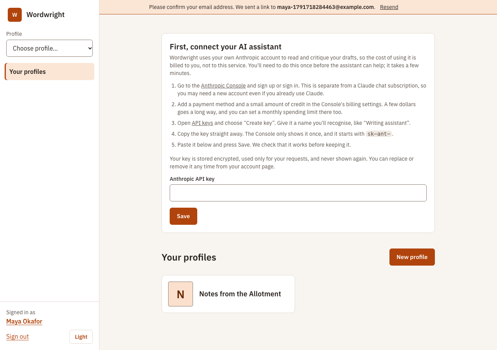
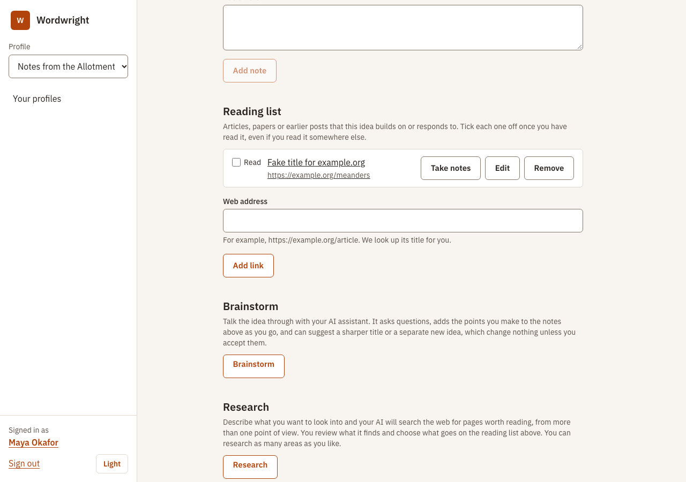
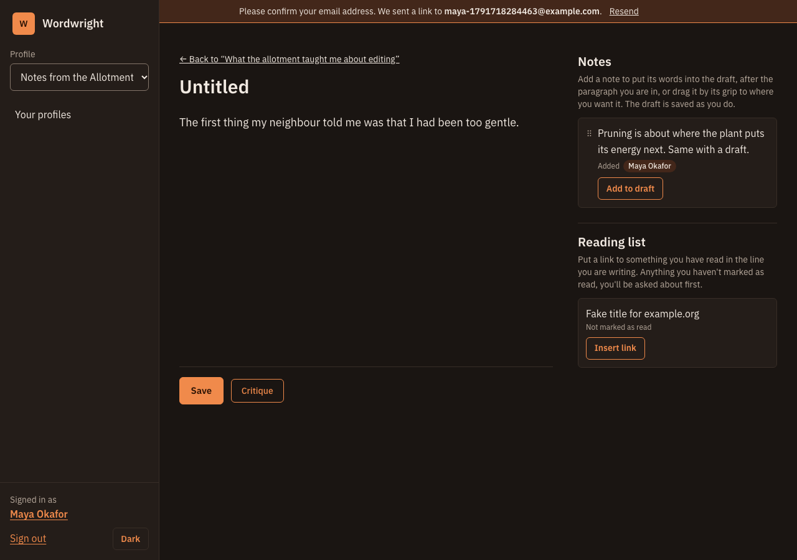
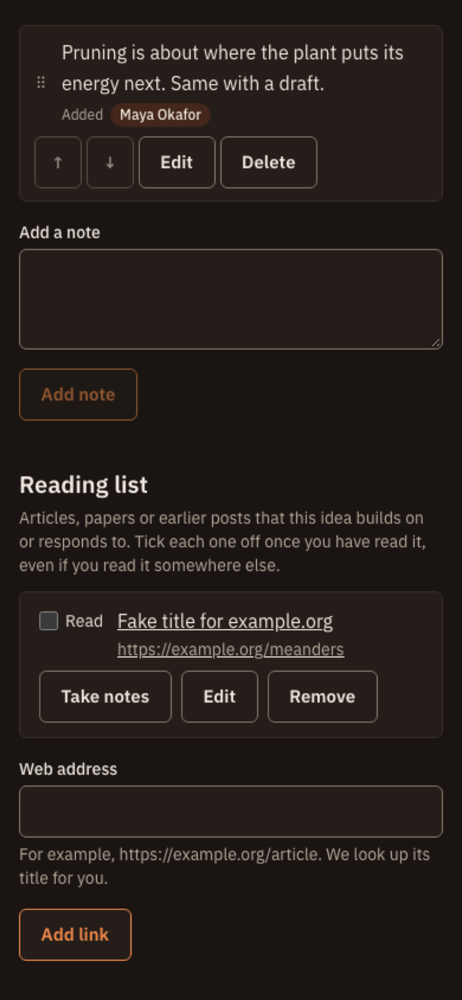
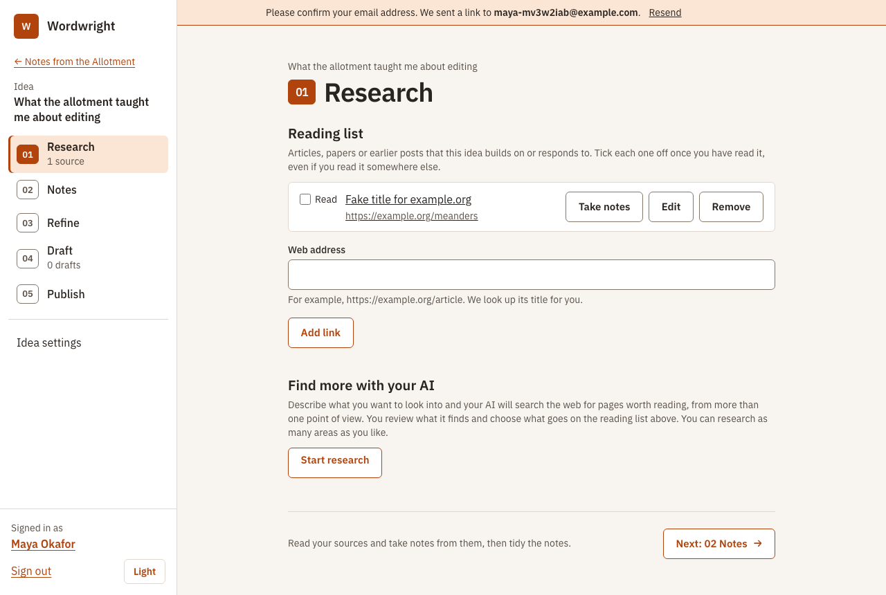
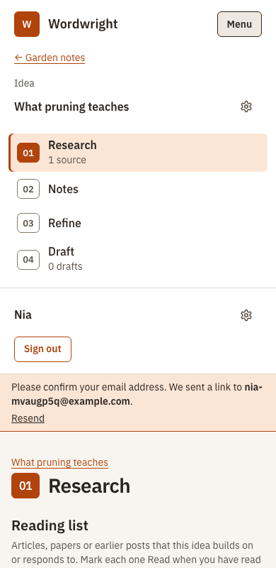

# Design system: Ember

How Wordwright looks, why, and how to keep it that way. Read this before changing anything people see. The short
version is in [AGENTS.md](../AGENTS.md); the reasoning behind choosing this design, and the alternatives we dropped,
are in [decisions.md](decisions.md#visual-design-ember) and the archive in [design-concepts/](design-concepts/README.md).
How the words read (voice, buttons, errors, length) is in the [style guide](style-guide.md); this file decides where text goes.

**Ember** is a calm, clear tool for writing: warm stone neutrals, one burnt-orange accent, IBM Plex Sans everywhere,
a side menu, 1px outlines on everything you can press or type in, and a designed dark mode.

## What it looks like

The running app (these are screenshots of the real thing, not mock-ups):

|                                                         |                                                                     |
| ------------------------------------------------------- | ------------------------------------------------------------------- |
|                 |                        |
|  |  |

## The principles

1. **Calm, not busy.** Few colours, generous space, no shadows, gradients or decoration. Content leads.
2. **Obvious what you can do.** Every button and field has a fill or a visible 1px border; links are always
   underlined; icon buttons keep a faint outline. Colour is never the only signal (errors say so in words, with an icon).
3. **One sans, everywhere.** The editor, the AI's replies and the chat use the same family as the buttons, only
   larger and looser. No serif, no monospace for metadata.
4. **The highlighter is rationed.** The pale `mark` colour means "the AI suggested this". Use it for nothing else. If
   it is everywhere it marks nothing, and the writer's own words must stay visually theirs.
5. **Roles, not colours.** Markup says what something _is_ (`bg-surface`, `text-ink-soft`, `btn btn-primary`), never
   what it looks like (`bg-white`, `text-stone-600`). That is what makes palettes and designs swappable.
6. **Other people's pictures are guests.** Logos and icons from other websites never appear bare (below).
7. **Accessible by construction.** The palette's contrast is tested; focus, target size, text size and motion are
   handled once in the theme, not per screen.

## Where it lives

| File                                                    | Job                                                                                                                                                                                               |
| ------------------------------------------------------- | ------------------------------------------------------------------------------------------------------------------------------------------------------------------------------------------------- |
| `apps/web/src/theme/palette-ember.css`                  | **The only place a colour is chosen**: light, dark, and lettered-tile tints, each named by role.                                                                                                  |
| `apps/web/src/theme/theme.css`                          | The design built on a palette: fonts, the Tailwind token map, shared base rules (focus, selection, reduced motion), and every component utility (`btn`, `field`, `panel`, `chip`, `callout` ...). |
| `apps/web/src/style.css`                                | Imports the two above, plus the editor and Markdown typography.                                                                                                                                   |
| `apps/web/src/theme/palette.test.ts`                    | Fails if any colour pair on screen drops below WCAG 2.2 AA, in light or dark.                                                                                                                     |
| `apps/web/src/lib/useTheme.ts`                          | The System/Light/Dark choice (Light and Dark saved in `localStorage` and applied as `data-theme` on `<html>`; System removes both and follows the device, the default).                           |
| `apps/web/src/assets/fonts/`                            | Self-hosted IBM Plex Sans (OFL). No third-party font requests.                                                                                                                                    |
| `apps/web/src/App.vue`                                  | The shell: side menu (a Menu button on phones), skip link, landmarks.                                                                                                                             |
| `apps/web/src/lib/nav.ts`, `components/SideMenu.vue`    | What the side menu lists for where you are (see _Navigation_).                                                                                                                                    |
| `components/StepHeading.vue`, `components/NextStep.vue` | A numbered step's title, and its \"Next: …\" suggestion.                                                                                                                                          |

Tailwind's default colour palette is **switched off** (`--color-*: initial` in `theme.css`). A class like `bg-red-50`
or `text-stone-600` does nothing, so off-palette colour can't creep in unnoticed. Only the roles below exist.

## Colour roles

Use the role that matches the _meaning_. Values below are Ember light; dark has its own set in the same file.

| Role (Tailwind class)                                  | Light     | Use                                                                                                                                                                   |
| ------------------------------------------------------ | --------- | --------------------------------------------------------------------------------------------------------------------------------------------------------------------- |
| `paper` (`bg-paper`)                                   | `#f8f5f1` | The page                                                                                                                                                              |
| `surface` (`bg-surface`)                               | `#ffffff` | Raised areas: panels, cards, inputs, the side menu                                                                                                                    |
| `sunken` (`bg-sunken`)                                 | `#eee8e0` | Recessed areas: code, disabled fields, quiet hover, secondary panels                                                                                                  |
| `hover-wash` (`bg-hover-wash`)                         | `#eee8e0` | The fill under the pointer on a quiet control (an icon button). A soft step off its surface in both modes; `sunken` is near-black in dark, so it is not used for this |
| `ink` (`text-ink`)                                     | `#2a2420` | Body text                                                                                                                                                             |
| `ink-soft` (`text-ink-soft`)                           | `#594f47` | Secondary text: hints, dates, counts, explanations. **Not** for disabled-looking text that must be read                                                               |
| `line` (`border-line`, `divide-line`)                  | `#e0d8ce` | Decorative dividers and quiet panel edges                                                                                                                             |
| `line-strong` (`border-line-strong`)                   | `#85786b` | Borders you need to see: fields, neutral buttons (3:1)                                                                                                                |
| `accent` (`bg-accent`, `text-accent`, `border-accent`) | `#b0440c` | The single brand colour: primary buttons, links, current item, focus ring                                                                                             |
| `accent-strong`                                        | `#8a3207` | Hover and pressed                                                                                                                                                     |
| `on-accent` (`text-on-accent`)                         | `#ffffff` | Text or icons placed on `accent`                                                                                                                                      |
| `accent-wash` (`bg-accent-wash`)                       | `#fbe6d6` | Tinted background: notices, counts, the current menu item, hovered cards                                                                                              |
| `mark` (`bg-mark`)                                     | `#cfe6f2` | The highlighter. **AI-suggested things only**                                                                                                                         |
| `danger`, `on-danger`, `danger-wash`                   | raspberry | Errors and destructive actions. Raspberry, not red, so it never looks like the orange accent                                                                          |
| `ok`, `ok-wash`                                        | green     | Success                                                                                                                                                               |
| `focus`                                                | `#b0440c` | Keyboard focus ring (set globally; you rarely touch it)                                                                                                               |
| `tint-1`..`tint-6` (`tint-1` class)                    | muted     | Lettered tiles when there is no picture                                                                                                                               |

Rules:

- **Never write a colour value** (hex, `rgb()`, a Tailwind palette name) in a component. If you need a new role,
  add it to the palette file (light, dark, and the system-dark copy), map it in `theme.css`, and add its pairs to
  `palette.test.ts`.
- **Don't use `accent` for decoration.** It means "you can act here" or "this is where you are". `accent-wash` is the
  background for information that isn't an action.
- **Text on a coloured background uses the matching `on-` role or `ink`**, and the pair must be in the test.
- **Danger is for errors and irreversible actions only.** Pair it with words and, where space allows, an icon.

## Type

IBM Plex Sans in four files (400, 400 italic, 500, 600). Sizes, set once:

| Use                                   | Class / rule                             | Notes                                                          |
| ------------------------------------- | ---------------------------------------- | -------------------------------------------------------------- |
| Page title                            | `h1`                                     | 28–38px, 600, balanced                                         |
| Section heading                       | `h2`                                     | 20px, 600                                                      |
| Subsection / card heading             | `h3`                                     | 17px, 600                                                      |
| Body, labels, buttons                 | default (16px) / `text-sm` for secondary | Never below 14px for anything read, 12px only for tabular tags |
| Secondary line (dates, hosts, counts) | `meta`                                   | 14px, `ink-soft`, tabular figures                              |
| The editor and the AI's replies       | `.prose-editor`, `.markdown`             | 18px, line-height 1.75, same family                            |

Figures are tabular by default so counts and dates align. Don't add other typefaces. Headings use `font-display`
(currently the same family), so a different display face is one line in `theme.css`.

## Shape, space and depth

- **Corners:** `rounded-ctl` (6px) for buttons and fields, `rounded-panel` (10px) for panels, cards and dialogs,
  `rounded-full` for chips and avatars only. Don't use bare `rounded` (it is not defined in this system).
- **Edges:** 1px. A quiet `line` for containers, `line-strong` for controls, `accent` for the current/hovered thing.
- **No shadows or gradients.** Separation comes from tone (`paper`/`surface`/`sunken`) and a 1px edge.
- **Spacing:** Tailwind's scale; page sections `mb-8`–`mb-12`, panel padding `p-4`/`p-5`/`p-6`. Read neighbouring
  screens first and match them.

## Components (utilities in `theme.css`)

Use these instead of long utility strings. If you find yourself repeating a recipe, add a component here.

| Class                                                             | Use                                                                                                                                                                                                                                                                                                                                                                                                                                                                                                                                    |
| ----------------------------------------------------------------- | -------------------------------------------------------------------------------------------------------------------------------------------------------------------------------------------------------------------------------------------------------------------------------------------------------------------------------------------------------------------------------------------------------------------------------------------------------------------------------------------------------------------------------------- |
| `btn` + `btn-primary`                                             | The one main action on a screen                                                                                                                                                                                                                                                                                                                                                                                                                                                                                                        |
| `btn btn-outline`                                                 | A secondary action that matters (e.g. Brainstorm, Open)                                                                                                                                                                                                                                                                                                                                                                                                                                                                                |
| `btn btn-neutral`                                                 | Everything else: Cancel, Previous/Next                                                                                                                                                                                                                                                                                                                                                                                                                                                                                                 |
| `btn btn-danger` / `btn btn-danger-solid`                         | Delete: outline to start, solid only on the final confirmation                                                                                                                                                                                                                                                                                                                                                                                                                                                                         |
| `btn btn-quiet`                                                   | Low-emphasis text actions and reorder grips. Keeps a faint outline                                                                                                                                                                                                                                                                                                                                                                                                                                                                     |
| `btn-sm`                                                          | Add to any `btn` in dense lists (36px high; normal is 44px)                                                                                                                                                                                                                                                                                                                                                                                                                                                                            |
| `btn-ghost`                                                       | An icon-only button with no border or fill at rest, the icon in `ink-soft`; `hover-wash` fill on hover and focus (`line` on a recessed strip); `accent-wash` and an accent icon when it is the current page (`aria-current`) or a toggle that is on (`aria-pressed`). Add `btn-ghost-danger` for Remove (raspberry on hover, focus and while armed)                                                                                                                                                                                    |
| `btn-icon`                                                        | With `btn-sm btn-ghost`: a square button holding only an `Icon`, named by an `aria-label` and a tooltip                                                                                                                                                                                                                                                                                                                                                                                                                                |
| `AiButton` (with a `btn` variant)                                 | Every button that makes an AI request, or leads straight to one: see _AI buttons_ below                                                                                                                                                                                                                                                                                                                                                                                                                                                |
| `switch` (+ `SwitchField`)                                        | The on/off state of one thing, saved when flipped (Read, Keep, Show read). Never a checkbox: see _Actions and lists_                                                                                                                                                                                                                                                                                                                                                                                                                   |
| `list-rail`                                                       | The left zone of a list row: select checkbox; for reorderable lists it is the drag handle (`list-rail-grab`, with a `list-rail-grip` glyph) and holds the arrows                                                                                                                                                                                                                                                                                                                                                                       |
| `field`, `field-compact`                                          | Text inputs, selects, textareas. Focus turns the thin border to the focus colour (no extra ring). `aria-invalid="true"` gives the error style. Use `TextField`/`TextAreaField` for labelled ones                                                                                                                                                                                                                                                                                                                                       |
| `RowList`                                                         | The frame of every list of records: a bordered box, rules between rows, content then actions in each row, an optional left rail. A row's own note (a reason a button is disabled) is a `basis-full` paragraph inside the row. `bare` is for rows that are one whole link or set their own padding. Not on it: lists whose rows are their own `li` component with a rail and tags (`IdeaLinkItem`, `RecentPostRow`), callouts (handover requests) and plain lines of text (copies sent, edit history). `ReorderableList` is built on it |
| `panel`, `panel-sunken`                                           | A grouped container. Put `divide-y divide-line` on a list inside it                                                                                                                                                                                                                                                                                                                                                                                                                                                                    |
| `card`                                                            | A whole-area link or button that lifts on hover (e.g. a publication). Add layout classes yourself                                                                                                                                                                                                                                                                                                                                                                                                                                      |
| `chip` + `chip-accent` / `chip-ai` / `chip-ok` / `chip-quiet`     | Small labels. `chip-ai` is the highlighter: AI-suggested only. `chip-quiet` is a flat fact (where an item came from)                                                                                                                                                                                                                                                                                                                                                                                                                   |
| `callout` + `callout-danger` / `callout-ok`                       | A notice with words in it. Use `role="alert"` for errors, `role="status"` for confirmations                                                                                                                                                                                                                                                                                                                                                                                                                                            |
| `link`                                                            | A link inside UI chrome. In running text, plain anchors are underlined by default styles                                                                                                                                                                                                                                                                                                                                                                                                                                               |
| `tab` (+ `TabPanels`)                                             | Tabs for areas that share one place (beside the draft: Notes, Reading list, Comments; a tab carries no count, so the bar never wraps), and for a short row of ways to do one job, each with its own small form (Home's Quick add). A tab list may be the top of a `panel` and stand in for its title. Selected is bold with a heavy underline and `aria-selected`; arrow keys move; panels stay mounted. The tab names its panel, so a heading inside repeats nothing visibly: it is `sr-only`                                         |
| `meta`, `h1`, `h2`, `h3`                                          | Type, above                                                                                                                                                                                                                                                                                                                                                                                                                                                                                                                            |
| `source-mark`, `source-letter` (+ `tint-N`, `mark-sm`..`mark-xl`) | The plate for other sites' pictures. Use through `PublicationImage` rather than by hand                                                                                                                                                                                                                                                                                                                                                                                                                                                |

### AI buttons

Every press of a button that sends something to the writer's AI spends tokens on their own key, so the button says so
before it is pressed and while it works (`docs/responsible-ai.md`: the writer is always told what an AI call is).

- **One component, `AiButton`**, takes the place of the `<button>`. Give it the `btn` variant the action already
  has (Critique is `btn-outline`, Send `btn-primary`): the AI mark does not change the hierarchy, and there is no
  separate "AI colour". It carries the **AI icon** (`Icon name="ai"`, sparkles) beside the visible label.
- **Busy:** pass `busy` and `busy-text`. The icon is replaced by a spinner (`Icon name="working"`) of the same size,
  the label does not change (so the button keeps its width), the button is disabled with `aria-busy="true"`, and
  `busy-text` is read out through a polite live region the component owns (don't add a second status for the
  same wait). Under reduced motion the spinner stays still: the busy button and its words are the signal.
- **Meaning:** the icon is never alone. The words "Uses your Anthropic key, so it costs tokens" are the button's
  tooltip and its accessible description, and the help page "Your AI settings" (`/help/ai-settings`, linked from the info icon on Your AI) explains the mark once.
- **Which buttons:** the ones whose press makes an LLM request (Critique, Brainstorm's Start/Send/Try again, Research,
  Research) and the ones that hand straight over to one (the Send and Start on an idea's landing page,
  which open the conversation where the reply is written). Not the buttons around them: Add note, Accept or
  Dismiss on a suggestion, Stop. The API-key check on saving the key is not shown as an AI action (the owner's call).
- **Adding one:** tag the API function `@ai` in `lib/api.ts`, use `AiButton` where it is called, and list it in
  `lib/ai-buttons.test.ts`, which fails when an AI call is used by a component without the pattern.

### The editors' toolbar, link dialog and Markdown mode

Both editors share **`EditorToolbar`** (`role="toolbar"`, "Formatting"): **icon-only buttons** (`btn btn-sm btn-icon btn-ghost` + `Icon`), each with an
`aria-label` and a tooltip that gives its shortcut ("Bold (Ctrl+B)", ⌘ on a Mac), and `aria-pressed` for what is on at the cursor (pressed shows
as `accent-wash` and an accent icon, like the current page). The bar is **one tab stop**; the arrow keys, Home and End move along it. Each editor
chooses its tools (`DESCRIPTION_TOOLS`, `DRAFT_TOOLS` in `lib/editor-tools.ts`); adding a tool is one entry there and an icon in `Icon`.

- **Draft** (`RichEditor`): a three-way text-style control (Paragraph, Heading 2, Heading 3: a `role="group"` of buttons, not a menu), then Bold,
  Italic, Inline code, Quote, Bulleted list, Numbered list, Code block, Link, Remove link, and at the far right **Edit as Markdown**. It is **sticky** at the
  top of the draft, and absent for someone who may only read it. There is no Heading 1 (the title is separate), strike-through or rule button.
- **Description** (`DescriptionEditor`): Bold, Italic, Bulleted list, Numbered list, Link, Remove link. Nothing else, since the page shows no more.
- **Narrow screens:** the buttons that do not fit the width move into a **More** menu (a disclosure of the same buttons; Escape closes it and
  returns focus to its button). The bar never wraps or scrolls. The Markdown button stays in view.
- **Remove link** is an action, not a state (no `aria-pressed`): it is disabled unless the cursor or some of the selection is in a link, and the
  arrow keys skip it while it is. With words selected only they lose the link; with just the cursor in a link, the whole link goes.
- **Link dialog** (`LinkDialog`, built with `useModal`): "Add a link" or "Change link" with one field, Cancel, Remove link when the cursor is in a
  link, and the "Enter a web address…" error inline. Focus goes to the field and returns to the button; Escape cancels.
- **Markdown mode** (drafts only): the button swaps the editor for a monospace `<textarea>` with the same Markdown (`aria-pressed`; remembered in
  this browser, in `localStorage`, never account data). The formatting buttons hide; the comments tab says "Comments cannot be shown while editing
  Markdown."; Comment and Rephrase are `aria-disabled` and say why when pressed (they work on the formatted draft); the notes and links from the side bar still work, at the cursor. Switching back loads the text
  into the editor without counting as an edit.

`DescriptionEditor` is a small rich-text field for short, formatted text (today the publication description), so people don't have to know
Markdown: the toolbar above a `field`-styled text box that looks like the text it makes (it uses the `markdown` reading styles). Its focus
looks like any field: the border turns to the focus colour, with no ring inside it (the outlines stay, transparent, for forced-colours mode). It reads and writes Markdown. Use it for any other short formatted text; the draft editor (`RichEditor`) is the long-form one.

### Comment marks in the editor

A comment (the AI's or a person's) that is about a paragraph is shown beside it, in the editor, without touching the writer's words:
the paragraph gets a 3px edge, in the highlighter colour for the AI's comments and a plain line colour for a person's (the highlighter is only for what the AI suggested; the text itself is not tinted, so it stays visibly theirs)
and a small round numbered button (`comment-marker`, named "Comment 2"; highlighter fill with `is-ai`) at the end of its last line.
The number is the comment's place in the list, and its card in the **Comments** tab shows the same `comment-marker`. The card is a plain box (1px `border-line`) holding the marker and text as one button that shows the paragraph, then the Resolved switch; it repeats no excerpt. A general comment has a quiet "General" chip and the AI's a "Your AI" chip (also on the critique summary). The one being looked at has the accent edge and an outline, and `aria-current`.
Pressing a mark opens its comment in the **Comments** tab beside the draft (the drawer, on a phone), and pressing a
comment shows its paragraph in the draft (a drawer gets out of the way first): there is no separate "show" button. The draft's editor gets a **Resolved** switch on each comment (a state of the comment, so a switch and not a button): a resolved comment is hidden, with its mark, unless the editor turns on **Show resolved**. Showing one scrolls the draft so the paragraph is at the top of the window and the comments so the comment is at the top of their area, side by side (`lib/scroll.ts`; smooth unless the person prefers less motion). To make that possible for the last paragraph and comment, the page and the comments area get spare room below their end while comments are showing. The
Marks are ProseMirror decorations (`lib/comment-marks.ts`): they are drawn, never saved, and never in
`getMarkdown()`. They sit at the end of the line rather than in the margin so they cost no width on a phone. A comment
whose paragraph has been rewritten loses its mark and moves to "This passage has changed" in the panel.

### Comment and Rephrase in the toolbar (#334)

The draft's toolbar ends with a small group, apart from the formatting and never in the **More** menu: **Comment** (speech-bubble icon, tooltip "Comment on the selected words or the paragraph you are in") and **Rephrase** (the AI icon, tooltip "Rephrase the selected words"), then the Markdown button. A button that can't be used now is `aria-disabled` rather than `disabled`, so it stays in the tab order (`ToolButton` `unavailable`); pressing it puts the reason in a status line under the toolbar (Rephrase: the selection reason; both in Markdown mode). A tutorial-only line under the toolbar covers both buttons. "Rephrase title" stays beside the title.

**Comment** acts on the paragraph holding the caret or the start of the selection. With the caret in the title, nowhere in the body clicked yet, or no paragraph found, it opens a general comment. The **composer** (`CommentComposer`) is a `panel` at the top of the Comments tab (it opens the tab, or the drawer on a phone, and takes focus): a heading "Comment on paragraph 4" or "General comment", the selected words quoted, a compact **General comment** switch, the member's "Only you and {name}, the editor, will see this." (the editor's own has no audience line), a "Your comment" field that starts as one line and grows to a cap (`max-h-28` on a phone, `max-h-52` from `sm`), **Add comment** and **Cancel**. There is no "added" message: the new card is the confirmation. The paragraph being commented on has the active edge while the composer is open.

**Selected words.** A comment made on words inside one paragraph keeps them (`quote`, up to 300 characters; the server keeps it only if the paragraph's text contains exactly those words). Where the paragraph still contains them they are underlined in the text (`comment-quote`: `line-strong` for a person, never the highlighter, which is the AI's); where it no longer does, the paragraph is marked as before. A selection across paragraphs puts the comment on the first, with no words.

**People without a toolbar** (a member who isn't the editor, and reviewers) get a sticky, right-aligned bar above the text with a spelled-out **Add comment** button (icon and words). Members use the composer in their Comments tab; reviewers get a dialog ("Add comment") with the same composer, which shows the selected words, or the start of the paragraph. A reviewer can only comment on paragraphs of their own snapshot.

### The Rephrase window and its options

Rephrase (a toolbar button, see _Comment and Rephrase in the toolbar_ above; available only while words inside one paragraph are selected, with the
reason in the line under the toolbar when it is pressed without) opens a **modal dialog** on top of the draft. It is built with `lib/modal.ts` (`useModal`,
shared with `ConfirmDialog`): focus goes in (to the Aim, since the wording is filled in), Tab stays inside, Escape and
Cancel close it, and focus returns to the Rephrase button. It is `max-w-2xl`, scrolls inside itself (`max-h-[90vh]`) and
fits a 390px phone. Order, top to bottom: the **current wording** (editable; a line under it says when only some of the words are bold, italic or linked, because new wording goes in plain, #244), the **Aim** ("What should it do?"), the
**Generate options** `AiButton` with "Round n of N" beside it and, in words, why it is disabled when it is, the options,
then **Cancel** and **Use this**. Nothing leaves the window until Use this.

**Rephrase title** (#163) sits beside the title field (the title wraps above it on a phone) and opens the same window, headed
"Rephrase the title", with no selection step. While the draft is too short it is disabled and the line under the title says
"Write more first. Options for a title come from what you've written."

- **Short wording** (a title, or up to 25 words) shows its options as a **list**: each row is the option and a
  `btn btn-sm btn-outline` **Replace wording** button, which puts it in the wording field. **Longer wording** shows a
  **carousel** (`RephraseOptions`): one option at a time, **Previous** and **Next** buttons (disabled at the ends), "Option
  2 of 4" announced politely, Left and Right arrow keys, and its Replace wording button inside the slide.
- The buttons repeat on every row but carry text, not an icon: "Replace wording" is the whole point of the row, and an
  icon alone would not say whether it replaces, copies or uses. Each has an `aria-label` that names its option.
- There is no copy or post button on an option, and no highlighter on them: they are choices, not suggestions already
  made. The highlighter stays for what the AI has put in the writer's text.

## Where explanatory text goes

Text lives in one of four places. Pick by what the person needs it for; how it reads is in the
[style guide](style-guide.md).

**The test:** if the person skips this text, can they still finish the task without a mistake? If so, it doesn't belong
on the page. Move it to an info icon or a help page, or cut it.

| Where                   | Use it for                                                                                                                                              | Examples from the app                                                                                                                                                     |
| ----------------------- | ------------------------------------------------------------------------------------------------------------------------------------------------------- | ------------------------------------------------------------------------------------------------------------------------------------------------------------------------- |
| **On the page**         | What the person needs to act or avoid a mistake _now_: the next step, what they will lose, what a field expects when that isn't obvious                 | The `NextStep` line. “This can’t be undone.” in a delete dialog. A hint under a field: “The address of the site”.                                                         |
| **Behind an info icon** | A short explanation of one control or term that most people won't need every time: why we ask, what a setting changes, what a button will spend or send | The `InfoTip` on Tag… “About tagging several at once”. The AI button's own tooltip: “Uses your Anthropic key, so it costs tokens”.                                        |
| **Tutorial mode**       | The same explanations written out on the page, for people new to the site, switched off once they know their way round                                  | Next to a Critique button: what a critique is and that it sends the draft to your AI. See _Tutorial mode_ below.                                                          |
| **On a help page**      | Anything longer than a short paragraph, anything with steps followed outside the app, anything people come back to                                      | Getting an API key from a provider (`/help/api-key`; the key screen holds only a link to it); what the AI mark means and why critiques are limited (`/help/ai-settings`). |

### On the page

- Short: two sentences at most per block (the length limits are in the style guide).
- Next to the thing it is about, and before the action, not after.
- What the AI button will spend or send is already said by its mark (see _AI buttons_) and its tooltip; don't repeat it
  as a sentence on the page. Something the person **can't take back** is on the page, before the action.

### Feedback after adding something

A form that clears itself still owes the person some sign that it worked, but not a message that sits there for good.

- **The result is on screen** (a note added above its own list, newest first): no visible words. A hidden polite status says
  "Note added." for screen readers, and the new row is marked for a couple of seconds (`accent-wash` and an accent edge,
  fading; the highlighter is for the AI only). Nothing depends on seeing the mark.
- **The result is somewhere else** (Quick add's "Added to X's notes", the reading form's "Added “X”. Open “X”"): the words
  and their link stay, since they point to something not on the page, and go as soon as the person starts the next entry
  or changes tab. Never a timer on text.

### Behind an info icon (`InfoTip`)

- **Text only, two sentences at most**, about one control or term. No links or buttons inside: the tip closes when the
  pointer or focus leaves, so they can't be reached. If it needs a link, it is a help page.
- **Keyboard and touch:** the icon is a real button with a name (`label`, “About tagging several at once”), reached by Tab. The
  tip shows on hover or focus, which a tap gives, and is the icon's description for screen readers.
- **Dismissable, hoverable, persistent (WCAG 1.4.13):** Escape closes the tip without moving focus, and it shows again
  on the next hover or focus. The pointer can move from the icon onto the tip without it closing.
- Never the only place for something the person needs to finish the task. That is what the test above catches.

#### Where the icon goes

The icon explains one control or heading, so it sits beside that, and **is never alone on a line**. (The look it
had when it fell on a line of its own, under a heading or a field, was the reason for these rules.)

- **After a button:** `Explain` in the same flex row, right after the button (Critique, Rephrase, New publication).
- **On a heading:** wrap the heading in `HeadingRow` with an `explain` slot: the icon is right-aligned on the
  heading's row. In tutorial mode the text is written out below the heading.
- **On a field:** the field's `explain` slot (with `explain-label`): the icon is at the right end of the label row, and in
  tutorial mode the text is written out under the label.
- **In a toolbar:** `Explain` with `ml-auto`, so it is at the right end of the row (bulk tagging).
- **Not for a whole panel or tab.** The side panel beside a draft is narrow and its tab names say what each is, so its
  explanations are `tutorial-only` (no icon). The same goes for anything that has no single control or heading to
  sit beside.
- **Text that avoids a mistake is plain text** (the hand-over dialog's “It remains yours until they accept it”), not
  behind `Explain`.

`expectNoLoneInfoIcons` (`src/testing/info-icons.ts`) is the test: call it, with tutorial mode off, on any page that
has an icon.

### Tutorial mode

New people need more than the icons give: what each kind of page is for, what the AI buttons do, what they will spend.
Experienced people find that same text noise. So the fuller explanations are written once and shown only in **tutorial
mode**, an account setting (`user_settings.tutorial_mode`) with a **Tutorial** switch in the account area of the menu,
always in view and always available both ways:

- **On for new accounts, off for everyone else by default.** Accounts that predate it stay off, so nobody already
  using the site gets new text on pages they know. A reviewer-only account never has it; when it becomes a full
  account it is turned on, as for any new account.
- **One component, `Explain`,** takes the same `label` and slot as the old `InfoTip`. Off: the icon and bubble. On: the
  same text written out below its control (at the end of its row), in `tutorial-note` (ink-soft, a thin left rule), no icon. `<Explain
tutorial-only>` is for what a page is for, which has no icon: it shows nothing when the mode is off. The text is
  written once, so the two versions can't drift. Two sentences at most in both modes.
- **It never adds anything the person needs to avoid a mistake:** that is on the page for everyone. Review checklist:
  take every `Explain` away; could the person still finish the task and avoid a mistake?
- **Kinds of page.** A route opts in with `meta: { tutorial: true }` and a `name`; the name is its kind. A test
  (`tutorial-routes.test.ts`) requires each opted-in route to have a test that renders it with `tutorialMode: true`.
  The content-crit issue for a page adds `meta.tutorial` with its text.
- **The switch.** The menu's account area has two compact rows: the person's name with **Sign out** and the settings
  button, then the **Tutorial** switch (the small size, since the row is crowded) with the **Help** link. Its tooltip
  (`v-tip`) says what it does. It shows the change at once and saves in the background. If saving fails it goes back
  to the saved setting and becomes `aria-disabled` (not `disabled`, so the keyboard can still reach the reason) until
  the page is reloaded, held in the component and not in storage; its tooltip then says so. There is no alert.
- **No offer, no reminders.** Nothing asks the person to turn it off, and nothing turns it back on. The switch is
  always in view, and a person who comes back after a break turns it on themselves. The help page says so.
- **Reviewer-only accounts** have no switch, because no page they can open has tutorial text. The first time one does,
  the switch is added to the reviewer header (beside Help and Sign out).

### Notices

The notice bar (`NoticeBar`) sits at the top of the content column of every signed-in page: in the column, not edge to
edge, and not sticky, so it scrolls away. A page can have more than one; **warn** comes first.

| Kind     | Means                      | Look (`notice` +)                                    | Example                           |
| -------- | -------------------------- | ---------------------------------------------------- | --------------------------------- |
| **warn** | Something needs doing      | `notice-warn`: accent border, `accent-wash` fill     | Please confirm your email address |
| **info** | An offer, nothing is wrong | `notice-info`: `surface` fill, `line` border (quiet) | An offer you have set going       |

- Each is a labelled `region` (not a live region, so it doesn't interrupt a screen reader). The text is short; the
  buttons sit under it and wrap at 390px. An info notice has a short title, one sentence, a primary button and a quiet one.
- A **quiet** page (`meta.quiet`, the editor) shows warn notices but holds back the notice bar's info notices, so nothing interrupts writing. **A notice the page draws about its own subject is not held back**: the editor shows, as notices under the bar, a handover waiting for an answer (warn) and an offer or request the person has set going, with its Withdraw button (info), so they never wonder whether Wordwright forgot what they did. Handover and review are buttons in a quiet row beside “← All drafts” that open dialogs (`ModalDialog`, or `ConfirmDialog` for Ask for this draft), so the writer stays on the draft.
- A notice that can fail says so in a `role="alert"` line with what to do next, and stays.

### Links that open in a new tab

- Use `NewTabLink` for every one. It adds the **new-tab icon** (`Icon name="external"`) after the link text, a tooltip
  (`v-tip`, “Opens in a new tab”: it shows on keyboard focus too) and hidden words “(opens in a new tab)” for screen readers, so the wording and the icon are
  written once. Never write `target="_blank"` or the words in a component.
- The words are never shown on the page. The icon is a convention, so there is no legend; `detail` adds to the spoken
  name where several links read the same (“Open the page”).
- **Exception:** links inside a person's own writing (rendered notes and drafts, and the editors, which open a link on
  Ctrl or ⌘ and click) carry no icon, so prose stays clean. The editor's hint line says how to open them.

### On a help page

- Linked from where it is needed by a **plain link in words** (“How to get an API key”), never by an icon, so it reads
  and is found like any other link. (A link from a help page out to another website is a different thing: it carries the
  new-tab icon like any outbound link.)
- **Opens in the same tab,** with a Back link to where they were. **Except** from a screen holding unsaved input
  (for example connecting your AI key): there it opens in a new tab, and the link says so with the new-tab icon (see
  _Links that open in a new tab_), so nothing typed is lost.
- One topic per page, steps numbered 01, 02 as elsewhere, a title that names the task.
- **Is there a help area yet? Yes.** `/help` lists the pages; each is a view (`HelpApiKeyView`, `HelpPrivacyView`)
  inside `HelpPage`, which supplies the title and a **Back** link (to the page the person was on, or **All help** when
  they came straight here). Help is open to everyone, signed in or not, so it is `meta: { open: true }` and has no
  menu level or step. It is reached from **Help** in the side-menu footer (beside Sign out), the reviewer bar, and under
  the name on signed-out pages. To add a page: a view, a route (before the `/help/:rest(.*)` catch-all), and a line in
  `HelpView`. Functionality that changes must update its help page (AGENTS.md, Definition of done).

## Actions and lists

Which control for which job, so every list (reading lists, notes, feeds, drafts) looks and behaves alike. The reading
list and the notes are the reference implementations: `ReadingList.vue`, `IdeaLinkItem.vue`, `IdeaNotes.vue`,
`ListToolbar.vue`. Drafts and feeds use the same rail and icon buttons.

**Checkbox, switch, button or link**

| It...                                             | Use                                 | Examples                                         |
| ------------------------------------------------- | ----------------------------------- | ------------------------------------------------ |
| selects an item for a bulk action                 | **checkbox**, in the left rail      | Select this item, Select all                     |
| sets a state of an item that stays, saved at once | **switch** (`SwitchField`)          | Read, Keep                                       |
| sets a view option for the list                   | **switch** or a select, on the left | Show read items                                  |
| does something or opens something                 | **button**                          | Edit, Tag, Remove, Move to…, Add to reading list |
| goes somewhere                                    | **link** (underlined)               | The title                                        |
| changes which of a few views or forms is showing  | **tab** (`TabPanels`)               | Notes / Reading list / Comments; Quick add       |

- **Tabs show, buttons act, segmented controls set.** If clicking does nothing but change what is displayed (nothing is
  saved or sent), it is a tab, not a button. If it chooses a value for a setting (System / Light / Dark), it is a
  `segmented` radio group. Don't use `aria-expanded` buttons to fake tabs.
- **Checkboxes only ever mean "select".** Never use one to trigger an action or to hold a state; never use a button for
  a yes/no state.
- A switch that repeats on every row of a list (Read, Keep, Resolved) is **compact** (`<SwitchField compact>`, the
  `switch-compact` class): a smaller track, knob and label, but the same 44px-high target and the same visible label.
  So are the switches in a list toolbar or panel header (Show read items, Show resolved) and the option in the move
  dialog. A switch that sits alone on a page or in settings (Read on the item page) keeps the full size; the Tutorial switch in the menu is the small one.
- A switch's label is a fixed word ("Read", never "Unread"). On is shown by the knob's place and a tick, not by colour
  alone. It flips under the finger and goes back (`revert()`) if saving fails.
- Put explanations in `meta` text and only where they apply (an item that isn't kept says on which day it goes), not in
  the label.

**Icons or text**

- **Text** for an action that is the row's main verb, is unfamiliar, or has no standard icon (Move to…, Add
  item), and for everything in a list's toolbar. (The editors' formatting toolbar is the exception: icon-only, since its buttons are
  the familiar formatting symbols; see the editors' toolbar below.)
- **Icon only** (`btn btn-sm btn-icon btn-ghost` + `Icon`, no border) for actions that repeat on every row, are rare, and have a
  universal icon: Edit (pencil), Tag (label), Move, Remove (bin). The tag icon sits with the others, with or without tags; the tags themselves show under the item. Always an `aria-label` that names the item ("Remove A paper") and
  a tooltip (`v-tip`, below); a 36px target.
- **A single-use action on a page** may be icon-only too, when the icon is as universal and the action is quiet: the pencil
  beside a reading item's title (Edit title and authors). The same rules apply: an `aria-label` that says what it does,
  a tooltip, and a 36px target.
- **Tooltip on an icon-only button: `v-tip`, not `title`** (`lib/tip.ts`; on a `HoldButton`, its `tip` prop). The browser's `title`
  shows on hover only; `v-tip` also shows on keyboard focus, is appended to `<body>` so a menu or list can't clip it, stays while the
  pointer moves onto it, goes on Escape (focus stays), and is `aria-hidden`: the `aria-label` is the name, the tooltip a
  visible echo (or, for a hold-to-confirm button, the hint). A click or tap that focuses the button doesn't pop it up.
- **Icon with text** where the icon backs up the words, as in a destructive confirmation.
- At most one text button per row; the rest are icons.

**Emphasis: what draws the eye**

| Level          | Style                                            | For                                                           |
| -------------- | ------------------------------------------------ | ------------------------------------------------------------- |
| Primary        | `btn-primary`, one per screen area               | The page's main action (not in a list)                        |
| Section action | `btn-outline` (accent)                           | The thing the list is for: Add to reading list                |
| Row's verb     | `btn-neutral btn-sm`                             | Only where a row has one main verb a title link can't carry   |
| Row utilities  | `btn-ghost btn-sm btn-icon`                      | Edit; Remove (turns raspberry on hover or focus, not at rest) |
| Bulk actions   | `btn-neutral btn-sm`; Remove `btn-danger btn-sm` | Tag…, Move to…, Remove N (opens a dialog)                     |

Accent means "act here", so it appears at most once per visible group, never once per row. Repeated rows use neutral
and quiet buttons. A chip is a **fact**, not a control: use `chip-quiet` (flat) so that only what you can press has a
strong outline, and give an item one link (the title), with its host as plain text.

**Names of people.** A name is a `PersonChip` when it labels who recorded, wrote or edits something: a note's origin, a
comment, a Refine message, a draft's editor. It is always the name (your own too, never "You"), and "A former member"
when the account has gone and the name wasn't kept. A name inside a sentence ("asked by Ada", a callout, a handover
notice) is plain text, bold where it already is; a chip never sits inside running text.

**A rail that only drags.** A card that is a source to take from, such as a note or reading item beside the draft
(`DraftCard`), has the same rail and grip but no arrows and no click behaviour: dragging it onto the draft is the
only thing the rail does. It shows from `lg` up (a phone cannot drag), and the icon button **Add to draft** beside it
is the route for keyboards, touch and screen readers.

**The left rail and reordering.** Every list row has a `list-rail`, a fixed-width top-aligned zone holding the row's
select checkbox. On a reorderable list the rail is **the handle**: the whole rail is the drag area (a `grab` cursor, so a
tall row has a big handle) and it **tints to `accent-wash` under the pointer**, which shows how far it reaches. A **six-dot
grip** (`list-rail-grip`) says so. It is a plain glyph, with no outline or fill, so it does not read as a button of its
own, and it is faint at rest (`line-strong`, 3:1) and darker on hover. It sits under the checkbox in its own space;
nothing is drawn behind a control. Reordering without dragging is always available: **clicking or tapping a rail** (or
focusing its hidden "Reorder" button) swaps the grip for small up/down arrows, on **all rows or none**, in the same slot
so nothing moves. Hover alone never shows them, so the grip is there when the pointer arrives. They go again when the
person clicks a rail away from the arrows (a click on a rail toggles them), clicks elsewhere, leaves the list, presses Escape or starts dragging, so the two never compete. For the
keyboard and screen readers the hidden button is there too (with it focused, the arrow keys move the row). The arrows
are 28px (above the 24px WCAG 2.2 minimum), an exception to the 36px rule for small buttons because there are two to a
row; their background is solid, a disabled one included (`btn-rail`). A list is
**either reorderable or paginated, never both** (you can't drag across pages). Long items clamp their titles to two
lines; the actions stay top-right and wrap below on a phone. Notes are the exception: show them in full.

**A note's row (`NoteCard`, `NoteText`).** Notes are shown in full, so a row can be tall: the list is `align-top`, which
puts the buttons at the top of the row, not centred. Where a note came from (“From” and the page's title as a link that opens in a new tab,
“From” and “conversation with your AI” (or “their AI”) as a link to the idea's Refine page, “Added”, then, on the line below, the name of the person who took it) is `meta` text in a column at the right, under
the row's buttons on the Note pages and alone on rows with no buttons (Recent notes, a reading item's notes); on a phone
it wraps under the note. It does not say the page's authors (the reading item's page does) or whether the note is a
quotation (its mark does). Tags stay under the note's text. A **quotation** is set apart by a `quote-mark`, a large
opening curly quote hanging before its first line. It is bare, with no box, so it is never mistaken for a control beside
the select box (hidden from screen readers: the text is in a `blockquote`). It is never a left border. The Note page's
own form is above the list and puts a new note first;
notes that arrive any other way go last.

**Posts from the feeds (`RecentPostRow`).** The Scan page's Recent posts and the Scan panel on a publication's landing page
show the same row, so a post looks and works the same wherever it turns up. The decision is two icon buttons, a **tick**
("Add to reading list: {title}") and a **cross** ("Ignore: {title}"), each with a tooltip (`v-tip`); a decided post shows ✓ or ✗
and a single **undo** button ("Reconsider: {title}"). A decision made in either place updates both (they share query keys),
and is announced in a polite live region. The list has no bulk actions, so it has no select rail or `ListToolbar`; the
Scan page pages it with `usePaging`-style `PageNav` and the landing panel shows only the top five waiting.

**Tags: one at a time (`TagEditor`, `TagEntry`).** Under each note and each reading-list link, beside its tags, a small
label-icon button opens a text field: type a tag and press **Enter**, and it is saved at once and the field stays,
emptied and focused, for the next (a comma also separates tags). While it is open each tag shows a small **×**, and a
small **tick** closes it. The tags already used on the list are offered as the person types. This is on every note,
**quotations included**: tagging changes none of their words. Tags are never entered in an edit form.

**Bulk tagging (`BulkTagFields`), on notes and on reading lists.** **Tag…** opens its form in the header (above). It uses
the same entry as a single note (type, Enter, again; the tags typed so far are chips that can be taken back out) and,
for each tag the selection already carries, a chip to press to take it off all of them (its title says "On 2 of the 3
selected"). The tick says what it will do ("Tag 3 notes"), the result is announced, and the selection is kept. The
change is one request and all or nothing, so a note that would exceed the limit refuses the whole thing and says which.

**The toolbar (`ListToolbar`).** On the **left**, after the select-all checkbox (which sits above the rail of row
checkboxes), a **filter button** with the funnel icon; on the **right**, once something is selected, the actions for the
selected items with a "3 selected" count. Until then the actions are not shown. The filters are folded away: the funnel
(`aria-expanded`, only offered when there is something to filter by) opens a row of them under the header (the
**Filter by tag** select, whose chosen tags stay beside it as removable chips named "Stop filtering by {tag}" and
narrow the list to what has all of them, and, on a reading list, the Show read items switch), which a close button folds again. While it is folded and a filter is
on, the funnel is marked and a small chip says what is filtering, so a filtered list never looks like the whole list.
**An action that needs input takes over the header**: Tag… and Move to… hide the other actions, and the rest of the
header holds their form, ending in a **tick** (confirm; named "Tag 3 notes", "Move 2 items") and a **cross** (cancel)
as icon buttons, to leave room. The wordy explanation goes behind an **info icon** (`InfoTip`: shown on hover, focus or
tap, and read as the icon's description) at the end of the form, or in very small text below it when there is one line.
**A list of one item has no header** (and no tick): each note, reading item and idea has its own **Move** icon (borderless, with Edit and Remove) that opens a dialog with the same form and moves that item alone. A list that can be filtered keeps its header for one row. $1 If the selection empties, the
form closes. Text on the actions that open the form, icons for the tick and the cross. Select all means the items
showing, after the filter, on this page; when there are more pages, "Select all N" offers the rest of the filtered
list. Selection clears when the filter or the page changes, so what an action touches is always what is on screen.

**Removing and deleting.** Two kinds, two controls (see [Confirming destructive actions](#confirming-destructive-actions)).
Removing one thing that has no consequences beyond itself (a note, a reading-list item, a feed, an invitation) takes a
press-and-hold (`HoldButton`). Removing several at once (the toolbar's Remove N or Delete N) asks in a dialog. A
hold-to-confirm button's tooltip says where to find the item again ("It stays in the feed it came from").

### Confirming destructive actions

One rule decides which control confirms, so the same kind of act always feels the same:

- **Deleting something from the server that takes other information with it** (an account, a publication, an idea, a
  draft; also clearing a whole conversation) asks in a **modal dialog** (`ConfirmDialog`). The dialog names what will
  go with it. Focus starts on Cancel. A whole-thing delete lives in a `DangerZone` at the bottom of its settings page,
  and its button opens the dialog. Never use the browser's `confirm()`.
- **Deleting or removing several at once** (the bulk Delete or Remove N in a list toolbar) also asks in a dialog that
  says how many, and is a text button, because more than one thing is at stake.
- **Removing a person from a publication, or leaving one, and changing someone's role** (making or removing an owner)
  affect what another person can do and where their drafts go, so each asks in a **dialog** that says what changes
  (the people list in publication settings; what each role can do is worded once, in `lib/publication-roles.ts`, and shown behind `Explain` beside the People and Invitations headings). They are text buttons, not icons, never underlined links.
- **Removing one thing with no consequences beyond it** (a note, a reading-list item, a feed, an invitation, a picture,
  an API key, a research run) takes a **press-and-hold** (`HoldButton`), with no dialog.
- **How they look:** a delete with a dialog is a **text button that says "Delete …"**; a hold-to-confirm is a **trash
  icon button** (`btn btn-sm btn-icon btn-ghost btn-ghost-danger` + `Icon name="remove"`) with an `aria-label` and a tooltip that starts
  "Press and hold, or tap twice, to …". The two are never mixed.
- **Holding and tapping:** a `HoldButton` is confirmed either by **holding** it for 1.5 seconds (a ring fills; one
  setting, `HOLD_MS` in `lib/hold-settings.ts`, so every button and the e2e tests agree) or by **tapping twice**: the
  first tap turns it into its verb with a question mark ("Delete?", `verb` prop), the second goes ahead. It goes back
  after a few seconds, when focus leaves it, or on Escape. An icon button grows to fit the word while armed. The same
  tap is what a screen reader's activation does.

**Pagination.** Notes show everything. Every other list pages client-side with `PageNav` above and below (the top one
announces the new range; the bottom one returns you to the top of the list), five at a time (`PAGE_SIZE` in
`lib/paging.ts`, `usePaging`). Filter first, then page; a new filter returns to page 1; removing the last item on a page
steps back one. No page controls when everything fits on one page.

## The mark

The Wordwright **mark** (see `CONTEXT.md`) is a flame whose tip is a split pen nib, one colour: the `accent` role. It names the product and
nothing else, so it appears in only four places and never as decoration:

| Where                                       | Size       | How                                                                          |
| ------------------------------------------- | ---------- | ---------------------------------------------------------------------------- |
| Side-menu header, reviewer header           | 36px tall  | Beside the word "Wordwright" (the link's name); replaces the old "W" tile    |
| Signed-out pages (sign in, register, reset) | 48px tall  | Centred above the word "Wordwright"                                          |
| Browser tab                                 | 16 to 48px | `public/favicon.svg` (follows the system's light or dark), `.ico` and `.png` |
| Home-screen icon                            | 180px      | `public/apple-touch-icon.png`: the mark on the `paper` colour                |

It never appears in empty states, loaders, buttons or as a watermark, never in place of a publication's picture or site icon, and not in
emails (they use no images). In the app it is the `BrandMark` component, an inline SVG in `text-accent`, because people can pin Light or Dark
whatever their system says and an `` of the file could not follow. The favicon is the one place that follows the system instead, since
browsers offer nothing else. The source drawing is `docs/design-concepts/icon/icon.svg`; `export/` holds the tidied mark, the favicon set and
PNG tiles (192 and 512, unused until Wordwright is installable). If the drawing changes, update `BrandMark.vue` and the files in `public/` from it.

## Pictures and logos from other sites

We can't control a favicon: it may be transparent, dark on transparent, full-bleed colour, white-backed, tiny or
the wrong shape. So it is never shown bare. `PublicationImage` with `kind="source"` puts it on a fixed-size **plate**: a
square, 1px `line-strong` frame, 4px corners, white background in both light and dark (so dark marks stay legible),
`object-fit: contain` (never cropped), `alt=""` (the name is always beside it). When there is no usable picture a
**lettered tile** in one of six palette tints stands in. The plate is square and barely rounded on purpose: the app's
own rounded corners stop at its edge and never wrap someone else's artwork. The plate's white is the only
hard-coded colour in the system, deliberately.

The exception is an icon that is **square to its corners** (#226): the server checks, when it fetches the icon, that it is
as wide as it is tall, at least 64px, and that all four corners (sampled just inside the edge) are opaque. Such an icon fills the plate (the frame
stays, no padding), since there is nothing to protect. Rounded or irregular icons, and small ones, stay contained as above.
The flag is `siteIconSquare` on a publication and `iconSquare` on a source (feed); pass it as `site-icon-square` or `square`.

The person's own publication picture (`kind="publication"`, the default) is cropped to fill the same frame, since the writer
chose it. When a publication has no picture but has a website whose icon we could fetch, `PublicationImage` is given
`site-icon-url` and draws that icon as a guest (on the plate, as above); the person's picture always wins. Pictures are still fetched once and served from our own origin ([decisions.md](decisions.md)); this is only
how they are framed. Identity-provider buttons ("Continue with Google") should use the same plate for their logo.

## Dark mode

Dark follows the person's system setting unless they choose. The **Appearance** control (`ThemeChoice`, a `segmented`
radio group: System / Light / Dark, at the foot of the side menu and in the reviewer bar) lets them pin Light or Dark,
and System hands control back to the device (`useTheme`). Dark is **not** an inversion: accents are lighter and more saturated (`#f08a4b`), buttons carry dark
text, washes are deep tints of the accent, and the highlighter becomes a deep blue-grey. All of it lives in the
palette file, so components need no `dark:` variants. If you find yourself writing `dark:`, a role is missing.

## Navigation: the menu follows you

How people are led through the app. The side menu **follows you**: what it lists depends on where you are, with a way
back up and the name of the thing you are in. (We drew three approaches, a steady menu with steps on the page and a
menu-as-a-map tree among them; this one won. See [decisions.md](decisions.md#navigation-the-menu-follows-you).)

| Level                | You are choosing…                            | The menu lists                                                                                                                                                             | Settings (a gear button)                                                                |
| -------------------- | -------------------------------------------- | -------------------------------------------------------------------------------------------------------------------------------------------------------------------------- | --------------------------------------------------------------------------------------- |
| Home                 | which **publication** to work on             | Publications                                                                                                                                                               | Beside your name in the menu foot                                                       |
| Publication          | what to gather                               | **01 Scan** (recent posts), **02 Read** (the reading list), **03 Note**                                                                                                    | Beside the publication's name, in the menu and on its landing page                      |
| Account              | which **setting** to change                  | **Your details**, **Your AI**, **Display**, **Sign-in and security**, **Download your writing**, **Delete account** (plain links, no numbers; way up "← All publications") | The gear in the menu foot, current across the whole group                               |
| Publication settings | which **setting** of a publication to change | **Details** (owners only), **Description**, **Feeds**, **Sharing**, **Download**, **Delete publication** (owners only; plain links, no numbers; way up "← {publication}")  | The gear beside the menu's "Publication settings" label, current across the whole group |
| Idea                 | how to develop it                            | **01 Research** (the AI research tool), **02 Read** (the idea's own reading list), **03 Note**, **04 Refine** (brainstorm), **05 Draft**                                   | Beside the idea's name, in the menu and on its landing page                             |

**Home with a publication.** Top to bottom; a section with nothing to show isn't drawn and leaves no gap: **Drafts to review**,
**Quick add**, **Keep writing**, then the publications. (Quick add and Keep writing sit together at the top of a publication's and an idea's landing page too, Quick add first; Quick add there is the same panel, with the place fixed and so no picker; on an idea's it has no New idea tab. **A reading item's page** uses it too, for taking notes from that item: Add a note comes first, with the quotation tick; Add to reading list says which item it added and links to it; New idea comes last, on a publication's item only.) _Quick add_ is three tabs (**New idea**, **Add a note**, **Add to reading list**) with no visible title (the section and the tab list are still named "Quick add" for a screen reader), each showing one small form. **New idea**
is showing on arrival, every time, so there is always a form and no Cancel. A publication picker
sits inside the form that is showing, above its field, and only when there is more than one; it starts at the publication last worked in (saved in `localStorage` when a
publication page opens or one is chosen here), else the one with the first draft to keep writing, else the first. A note or reading item goes to the publication's own list, never
into an idea, and the form says where it went and stays open for the next. _Keep writing_ lists the drafts the person edits that are active
(`GET /api/drafts/active`): saved in the last 30 days, or with a review in progress, or with comments they haven't resolved,
those with unresolved comments first. It starts with three; **Show more** adds three below them and moves focus to the first new
row. It is on Home (all their publications), a publication's landing page (that publication) and an idea's (that idea), and is
not drawn when nothing is active. A row is a `DraftRow`, the same one the idea's Draft page uses: the whole row is the link (no
"Continue"), with the title, then what the page doesn't already say about where it is (idea and publication on Home, the idea on a
publication's page, nothing on an idea's) and "Last changed", then how its reviews stand over all its requests ("2 of 5 reviews
complete · 4 unresolved comments"). The Draft page adds the editor as a name chip (`PersonChip`, as on a note) to every row,
the person's own included; Keep writing never does, as they are all theirs.

**First run (Home).** While a person has no publication or no AI key, the top of Home is a two-item checklist using the
same 01 / 02 badges: **01 Create your first publication** and **02 Connect your AI key (Anthropic)**. Neither blocks the
other. A finished step keeps its place with a tick in the badge and "done"; when both are done the checklist goes and the
list of publications stands alone. The heading is "Get started" and the action is the same "New publication" as beside the list (which shows only once there is a publication). What a publication is sits behind an info icon (`Explain`); body text in both steps is the same size and colour. While there
is no publication the list's own heading row and button are not shown (the heading stays as a screen-reader-only `h1`
that names the page); they appear once there is one. The pattern for any first-run block: one heading that says what it
is, no greeting, one name per action, and explanations behind `Explain`. The badges stay decoration (`aria-hidden`); the ordered list carries the order.

The principles (they are the point of the pattern; keep them when you add a page):

1. **Numbers orient; they never gate.** Every step is a link, always enabled. Nothing is locked, greyed out or
   "completed for you". The numbers are decoration (`aria-hidden`); an ordered list conveys the order.
2. **State is a count, not progress**: "2 feeds", "3 to read", "5 notes", "1 idea" under each of a publication's steps, and "2 sources", "5 notes", "1 draft" under an idea's (Refine has nothing to count). No progress bars.
   In the menu a long name is cut after two lines, and the website is always the words "Website" with the new-tab icon, never the address.
3. **See where you are in two places**: the current step is marked in the menu (`aria-current`, a filled badge and an
   edge) and in the page title, with the publication or idea name above it (`StepHeading`).
4. **A suggestion, not a push.** A step ends with `NextStep` ("Next: 04 Refine →"), an outline button, never the
   primary one. A step where the next move is a choice (Ideas), or the last (Draft), has none.
   **Steps are named with verbs** (Scan, Read, Note, Refine, Draft), because the page is something you do. The rule covers numbered steps only: settings pages and a publication's Ideas list name things.
5. **Visiting spends nothing.** A step that calls the AI waits for a button (Refine's **Refine with your AI**,
   the Research page's Research button); arriving by the menu must never cost the writer money.
6. **Always a way up**: "← All publications", "← {publication}".
7. **Settings sit apart from the steps**, at their own level, with no step current. They are reached by one **icon-only
   gear button** (`SettingsButton`: a link, 44px square, named "Account settings", "Publication settings" or "Idea
   settings", with the same words as its tooltip) placed beside the name of the thing it configures, never a text link
   in the list of steps. It is the same gear at every level; its name and its place say which. It is marked current
   (`aria-current`, `accent-wash`) on its own page. The **menu foot** holds your name (plain text) with the account
   gear, and a **Sign out** button (an action, so a button, not a link). Appearance is a setting, so it lives on the
   Display page. **Account settings are six short pages, not one long one** (`/account/details`, `/ai`, `/display`,
   `/security`, `/download`, `/delete`; `/account` redirects to the first), under an `account` level whose menu is
   plain links with no numbers, because settings are not a sequence. Each page is titled with `StepHeading` ("Account
   settings" is the small link above the title) and has no `NextStep`. A new setting goes on the page it belongs to; add a
   page only if none fits (`ACCOUNT_PAGES` in `lib/nav.ts`, plus a route with `meta: { level: 'account', step }`).
   **A publication's settings work the same way**, under a `publication-settings` level: **Details** (name, website,
   picture), **Description**, **Feeds**, **Sharing**, **Download** and **Delete publication** (`/p/:id/settings/details`, `/description`,
   `/sharing`, `/download`, `/delete`; `/p/:id/settings` redirects to the first the person can see: Details and Delete are for owners, so a member starts at Description). The menu's way up is "← {publication}"
   and its pages are plain links with no numbers (`PUBLICATION_SETTINGS_PAGES`; routes use
   `meta: { level: 'publication-settings', step }`). A member's menu leaves out Delete, and its address sends them to
   Details. The name and website fields are one component (`PublicationDetailsFields`) shared with New publication, so the two forms
   can't drift apart. **An idea's settings are one page, not a menu**, because it has only a name and a delete (`/p/:id/ideas/:id/settings`, under the `idea` level): its Save button reads "Save idea" and swaps to "Saving…" as Details does, "Saved" sits underneath, and its delete box, like the others, leads with "Download your writing" first.
8. **A level has a landing page** (a publication's, at `/p/:publicationId`; an idea's, at `/p/:publicationId/ideas/:id`) that is none of the numbered steps: a summary of
   each step (the newest feed posts; the first items to read; the latest notes; the ideas), with **Quick add** above them for adding an idea, a note or something to read, so the sections hold no forms of their own. Nothing in the menu is current there.
   The title row has the gear at its far end. **Describe this publication**, while there is no description, is a `NextStep top` right under the title row, and the publication's description comes next, then Quick add.
   Panels reuse the step pages' components, and, like the steps, visiting spends nothing. The page is titled with the
   publication's name (`h1`) beside its picture and website link, then the publication's description (Markdown, clamped to about eight lines with a
   **Show more…** / **Show less** button that appears only when text is hidden; an invitation to add one when empty); each section is a `LandingSection`: the step's number
   (from the same list as the menu) and title, with a light rule above to set it apart, and its "See all" and quick
   actions on the right of the heading. An idea's page is titled with the idea's name (the publication above it, as a way
   up), has Quick add (Add a note, Add to reading list: no New idea, and they go to the idea) and summarises Research (the box to ask the AI, which waits for
   its button, and a link to the research so far), Read (the unread reading list, as on a publication's page), Notes (shown by the same `NoteCard` as the Note step), Refine (the AI's latest message and a box to
   reply, or **Refine with your AI** with a line on what is sent) and Draft (its drafts, and **New draft**).
9. **The name leads back up to the landing page**: the publication's or idea's name in the menu, and the small name above
   a step's title, are links to it (current on the landing page itself, where the title is not a link).

|                                                           |                                                                   |
| --------------------------------------------------------- | ----------------------------------------------------------------- |
|  |  |
|   |                                                                   |

**How a page joins the menu.** Give its route `meta: { level: 'publication' | 'idea' | 'account', step: '<key>' }` in `router.ts`
(`step` is a key from `PUBLICATION_STEPS`/`IDEA_STEPS` in `lib/nav.ts`; leave it off for settings). Sub-pages of a step
(the research tool, reading one source) use their step's key, so it stays current. The title is
`<StepHeading>Name</StepHeading>`; end the page with `<NextStep :to label>why this is next</NextStep>`. A page that is
read beside another window (reading a source, taking notes) adds `compact: true`, which folds the menu behind the
**Menu** button at every width so two windows fit side by side. The drafting page keeps the menu on a laptop and finds
its idea from the draft (`ideaFromDraft: true`).

Adding a step (rare): add it to the step list in `lib/nav.ts`, give its route the meta, and update the table above
and in README. Renumbering is automatic.

**Publishing is not a step.** It is done to one draft, so it sits at the bottom of the Draft page (`DraftPublish`): **Copy**
(rich text, with plain text beside it, so it keeps its headings and links when pasted into an editor or an email) and
**Copy as Markdown** (title first), with a text box to select from if the clipboard is out of reach. Publishing straight to
a newsletter, and help drafting social threads, would add their own buttons there later; neither is built. Below them the
editor says when they have published it: a **switch** "I’ve published this draft" (a state, saved at once), and, once it is
on, a `callout-ok` (`PublishedNote`: the `chip-ok` "Published Oct 20, 2026", with a tick, and "View post" if there is a link) and an
optional **Link to the published post** (only `http:` and `https:` are accepted; it opens in a new tab and the service never
fetches it). Everyone who can read the draft sees the note, but only the editor sees the switch. Marking a draft published
takes it out of Keep writing, whatever else is true of it. On the idea's **Draft** page (`IdeaDraftsView`, rows are `DraftRow`s) a
published draft **keeps its place**, since the order is the reading order for a linked set. Its row is washed `ok-wash`, with the
same chip, and "View post" is its own link beside the row link (a link can't be inside one). There is no animation: the achievement
is the colour, and the row staying as a record. The text-on-wash pairs are in `palette.test.ts`. The old
`/ideas/:id/publish` address redirects to the idea's drafts, and the drafts list is the last step, with no next step.

## Layout

A **reviewer-only account** (someone asked to read a draft, see decisions.md "Reviewers") has no side menu: a single top
bar with the name, the Appearance choice, a **Start writing** button (the way to upgrade to a full account) and
Sign out, over one column. It has no settings gear: a reviewer-only account has no account page. Its pages (`ReviewsView`, `ReviewView`) use the
same cards, callouts and chips as everywhere else.

- **Side menu** (16rem) on desktop; on phones, and at every width on `compact` pages, a top bar with a **Menu** button
  (`aria-expanded`, `aria-controls`) that folds the menu away and shows where you are while closed. Opened, the menu is
  a **drawer** that slides in from the left over the page (it never pushes the content), behind the `scrim` that
  closes it when pressed. It is a modal dialog while open (`useModal`: focus moves in and returns to the Menu button,
  Tab stays inside, Escape closes) and it closes on navigation. No shadow: separation is the scrim and a 1px `line`
  edge. The slide is 0.15s and off under reduced motion. Signed-out pages have a centred name only.
- **Content width:** `max-w-3xl` for reading and forms; routes with `meta.wide` get `max-w-6xl` (the drafting page
  with its notes column). Check every screen at 390px; nothing may scroll sideways.
- **Landmarks:** the side menu is the page `header`; the page content is `main`; a skip link comes first. Don't add a
  second `aside` for the menu: tests and screen-reader users find the drafting notes by that landmark.

## Accessibility checklist (all built in; don't undo)

- Contrast: enforced by `palette.test.ts` (text 4.5:1, borders and focus 3:1) in light and dark.
- **Focus:** one 3px outline in `focus`, from the base layer. Don't remove outlines or restyle focus per control.
- **Targets:** buttons 44px (`btn-sm` and icon buttons 36px; the settings gear is 44px, since it sits alone), checkboxes 20px, switches 44px high with their label (44px wide too, except a compact switch in a list row, whose track is smaller but whose target is not).
- **Text:** 16px minimum in fields (stops iOS zoom), links underlined, no text in images.
- **Motion:** reduced motion is honoured globally; don't add animation that carries meaning.
- **Not by colour alone:** errors have words and (where it fits) an icon; AI-suggested things have a label, not just
  the highlighter; the current menu item has `aria-current` and an edge, not only a tint.
- Every async action keeps its loading, empty and error states; error text says what to do next.
- **Saving a form:** show what happened with `SaveStatus` (`:mutation`, or an array of every mutation the form can
  run). It says nothing while idle, "Saved" once it worked (or the words you give it, or its slot for a message that
  says more), and the reason in a `role="alert"` if it failed. Put it beside the button (`class="basis-full"` in a
  wrapping row puts it underneath), or above the button for a longer message. A field that starts from a saved
  value uses `useSavedValue`, so a refresh never wipes what the person is typing.
- **Loading a list or section:** wrap it in `QueryState` (`:query`, `what="the notes"`). It shows a quiet "Loading…",
  or "We couldn't load the notes." with a **Try again** button, and the content only once it has arrived; the empty
  state ("No notes yet.") belongs inside it. Pass `loading` to say what is loading ("Reading your feeds…") and
  `detail` when the server's reason helps ("Too many requests…"). A page about one idea or publication uses `IdeaGate` or
  `PublicationGate`, which also handle "not found".
- The e2e suite runs axe over the main pages. A new screen needs to be in it.

## Applying the design to a change

1. Find the nearest existing screen and copy its structure. Reuse components before writing utilities.
2. Build with roles and component classes. No colour values, no `dark:`, no shadows, no bare `rounded`.
3. Headings `h1` (once per page, `StepHeading` on a step) / `h2` / `h3` (no skipped levels); the primary action is the only `btn-primary` in its area.
   A new page in the app declares its level and step (see _Navigation_) and ends with `NextStep` where one fits.
4. Add the highlighter only if the AI produced it. Add a text label next to it.
5. External pictures go through `PublicationImage kind="source"`.
6. Look at it in light **and dark** and at 390px. Run `pnpm check` (palette test), `pnpm test:e2e` (axe).
7. If you needed a new colour, component or rule, add it to the palette/theme and **update this file**.

## Changing the design

- **Swap the palette:** copy `palette-ember.css`, change the values (keep every name), point the import in
  `style.css` at it, and run `pnpm --filter @wordwright/web test`. `palette.test.ts` reads `palette-ember.css`; change its
  path when you rename. The `docs/design-concepts/` folder shows teal and purple variants built the same way.
- **Change the look** (corners, fonts, weights): edit `theme.css`. Components pick it up everywhere.
- **Change the shell or the menu's shape:** `App.vue` (the frame) and `components/SideMenu.vue` / `lib/nav.ts` (what it lists).
- **Don't** fix a screen by adding colours or one-off classes to it. If a screen needs something the system lacks, the
  system is what changes.
